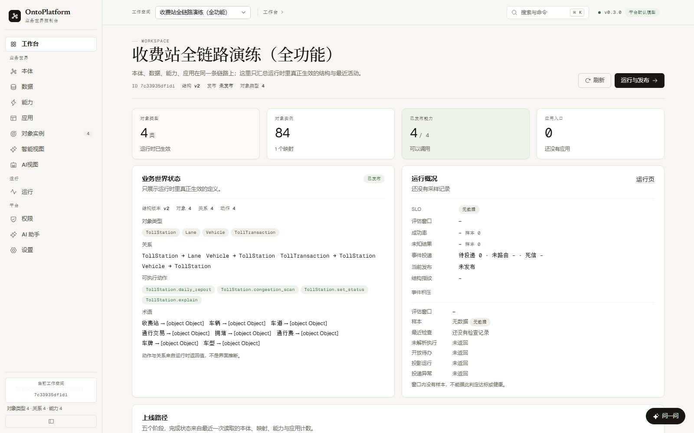
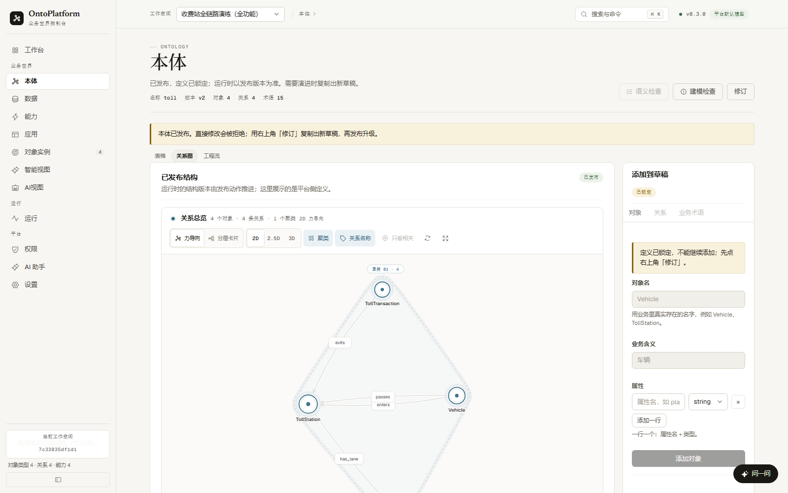
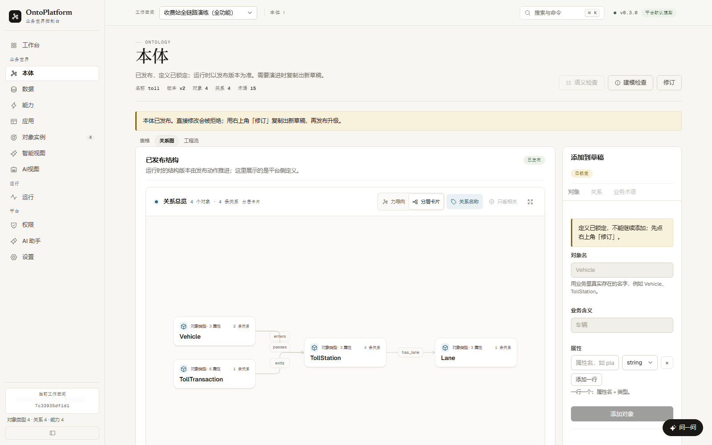
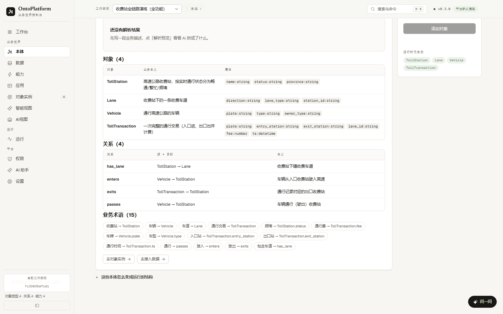
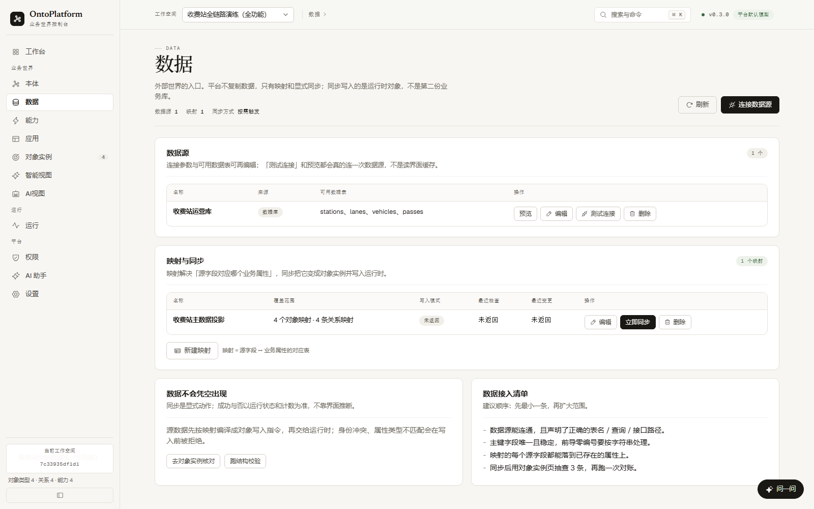
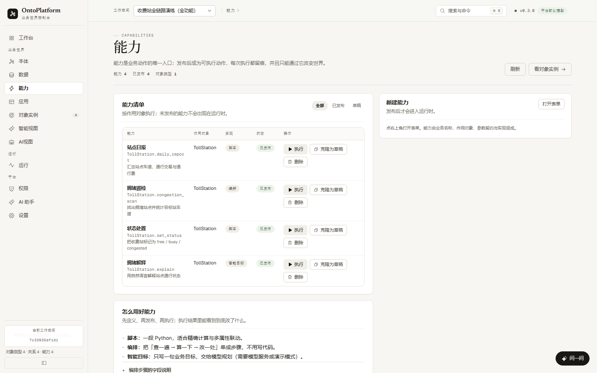
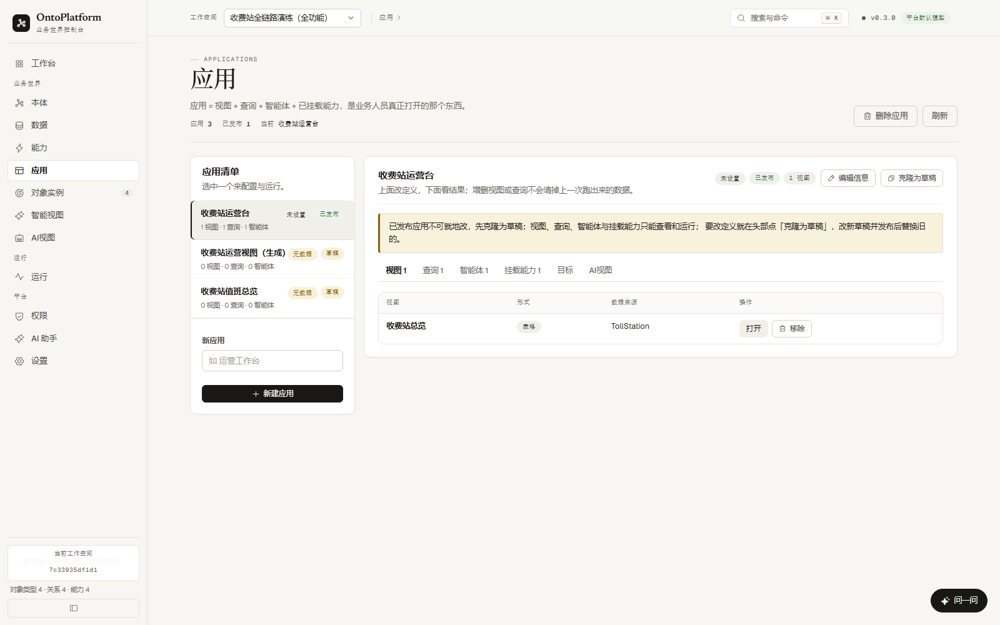
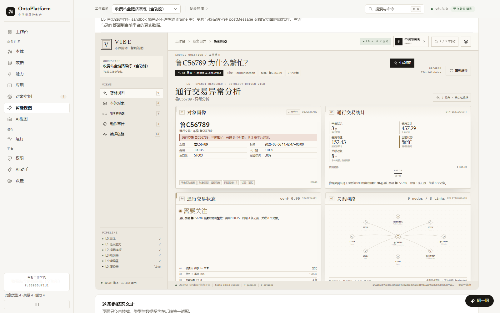
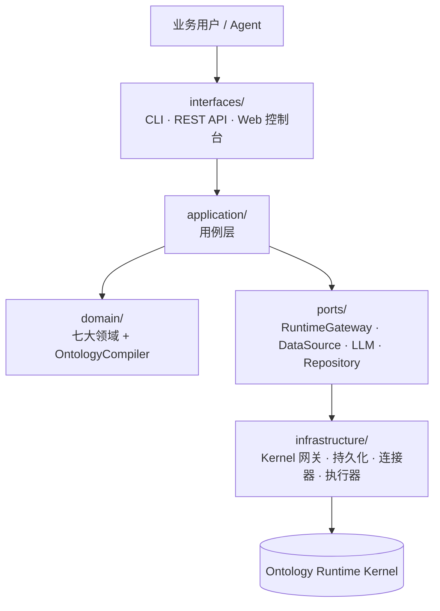

<div align="center">
  
  <h1>OntoPlatform</h1>
  <p><strong>本体智能应用平台</strong></p>
  <p>建模业务世界 → 接入现实数据 → 沉淀业务能力 → 组装应用<br />让 AI 在同一张本体上工作</p>
  <p>
    <a href="https://github.com/loongWoong/ontoPlantform/actions/workflows/ci.yml"></a>
    
    
    
    
    
  </p>
  <p>
    <a href="#快速开始">快速开始</a> ·
    <a href="#界面速览">界面速览</a> ·
    <a href="#核心功能">核心功能</a> ·
    <a href="#架构">架构</a> ·
    <a href="#文档">文档</a>
  </p>
</div>

> [!IMPORTANT]
> **Kernel 是引擎，Platform 是整车。**
> [Kernel](https://github.com/loongWoong/ontoRK) 只回答五个问题：世界长什么样（describe）、对象是什么（get）、找出对象（find）、对象之间有什么关系（related）、做一件事（invoke）。
> Platform 负责其余的一切：建模、发布、数据接入、能力沉淀、应用组装、语义检索、Agent 编排与治理，并通过**防腐层**把这一切编译成 Kernel 的语言。

## 目录

| 快速了解 | 工程深入 |
| :--- | :--- |
| [界面速览](#界面速览) · [核心功能](#核心功能)<br />[快速开始](#快速开始) | [架构](#架构) · [控制台](#控制台)<br />[智能视图](#智能视图) · [AI 视图](#ai-视图) |
| [为什么是 OntoPlatform](#为什么是-ontoplatform) | [能力拓展](#能力拓展) · [稳定性与边界](#稳定性与边界)<br />[开发与验证](#开发与验证) · [文档](#文档) |

## 为什么是 OntoPlatform

平台不是又一个“低代码表单”，而是把 Kernel 的能力组织成业务人员可以理解、操作和治理的世界。以下五条约束贯穿领域模型、用例与界面：

1. **Kernel 是唯一事实来源** —— 平台不缓存业务状态；发布 Schema 不动 State。
2. **一切通过能力改变世界** —— Agent 与应用都走 `Capability -> RuntimeGateway -> Kernel`。
3. **平台不 import Kernel** —— 只有 `KernelRuntimeGateway` 一处认识两个世界，kernel 懒加载。
4. **用户看到业务语言** —— 术语表（Vocabulary）把“收费站”翻译成 `TollStation`，Ask/Agent 永远不猜表名。
5. **治理内建** —— 生命周期状态机、工作区角色、审计日志是骨架的一部分，不是插件。

## 界面速览

Web 控制台的主内容区按可用宽度的 **90%** 自适应铺开，不设固定像素上限；以下截图来自 1600×1000 的真实运行实例（「收费站全链路演练（全功能）」工作空间）。

<p align="center">
  <a href="docs/screenshots/platform-workbench.png">
    
  </a>
</p>

<p align="center"><sub><strong>工作台</strong> · 五步主链路、运行时计数与下一步</sub></p>

工作台把「创建工作空间 → 定义并发布本体 → 接入现实数据 → 沉淀业务能力 → 组装业务应用」压到一屏：左侧是当前工作空间的真实对象、实例、能力与应用计数，右侧是五步进度、运行状态和最近活动；未完成步骤可直接跳到对应页面。

### 关系图：力导向 × 分层卡片

| 力导向（2D / 2.5D / 3D + 聚类） | 分层卡片 |
| :---: | :---: |
| [](docs/screenshots/platform-ontology-graph-force.png) | [](docs/screenshots/platform-ontology-graph-layered.png) |

力导向视图用圆形节点、方向箭头和关系标签表达对象与关系，并按图结构显示聚类凸包、聚类标签和底部图例；工具栏可以切换 `2D / 2.5D / 3D`、重新计算布局或只看选中对象的相关部分。切到「分层卡片」后，同一份本体换成从左到右的对象卡片和正交关系走廊，选中、详情、只看相关、缩放与全屏等交互保持一致。

## 核心功能

界面之下，平台围绕三条链路工作：**设计 → 运行**、**数据 → 状态**、**语言 → 状态**，最后把能力与查询组装成业务应用。下面按控制台里的实际页面拆开看。

| 本体：定义世界 | 数据：映射与同步 |
| :---: | :---: |
| [](docs/screenshots/platform-ontology-structure.png) | [](docs/screenshots/platform-data-projection.png) |
| **定义 → 发布，运行时锁定。** 对象类型、关系、业务术语都在这里维护；发布后成为运行时结构，演进时先「修订」出新草稿。 | **数据源 → 映射 → 显式同步。** 平台不复制业务库，只有点击「立即同步」才会把源数据编译成对象写入指令。 |

| 能力：业务动作的唯一入口 | 应用：视图 + 查询 + 智能体 + 能力 |
| :---: | :---: |
| [](docs/screenshots/platform-capability-actions.png) | [](docs/screenshots/platform-application-composition.png) |
| **脚本 / 编排 / 智能目标。** 能力有输入契约，发布后进入运行时；执行结果与变更都会留痕。 | **应用是业务人员真正打开的入口。** 已发布应用不可就地修改，先「克隆为草稿」，改完再发布替换。 |

### 智能视图：从本体编译到 L5

<p align="center">
  <a href="docs/screenshots/platform-smart-ui.png">
    
  </a>
</p>

智能视图不生成静态截图，也不另起一份样例数据：它读取当前工作空间的本体、能力和实例，经 L3 规划、L4 确定性编译生成 OpenUI 程序，再在 L5 的 sandbox iframe 中渲染。截图里的画像、统计、关系网络、状态解释都来自当前平台的真实投影；查询和动作会通过 `postMessage` 回到同一工作空间，而不是停留在演示数据上。

## 快速开始

### 1. 安装

```bash
python -m pip install -e F:/piAgent/ontoRK      # 按本机 kernel 仓库位置调整
python -m pip install -e F:/piAgent/ontoPlantform
```

> [!TIP]
> 平台核心刻意保持零运行时依赖；Kernel 是独立仓库，通过 `RuntimeGateway` 在 infrastructure 层接入。前端构建产物已提交进包内，**运行期不需要 Node**。

### 2. 一条命令跑通完整链路

```bash
python examples/traffic/demo.py
```

一条命令跑通七个领域：建模 → 发布 → 投影 → 能力调用 → 应用视图 → Ask/Agent → 治理。

另有一个金融租赁场景，用于验证智能视图对不同本体的普适性：

```bash
python -m examples.finance_lease.bootstrap --db .onto/platform.db --verify
```

它包含承租企业、租赁物、合同、租金账单和风险预警五类对象，装载后可在控制台打开「金融租赁智能风控」工作空间。

### 3. 启动控制台

```bash
onto-api --port 8100
# Web 控制台:  http://127.0.0.1:8100/
# API 根:      http://127.0.0.1:8100/api/health
```

控制台是 **React + TypeScript + Vite** 单页应用（`frontend/`），构建产物写入 `src/onto_platform/interfaces/web/dist/`，因此 `python -m onto_platform.interfaces.api` 一条命令即可同时提供 API 与界面。

<details>
<summary><strong>展开 CLI 速查：建模 → 投影 → 能力 → 运行时</strong></summary>

```bash
# 建模并发布
onto workspace create 高速运营
onto --workspace <wid> ontology create traffic
onto --workspace <wid> ontology add-object Vehicle --prop plate:string --prop balance:number
onto --workspace <wid> ontology add-relation passes Vehicle TollStation
onto --workspace <wid> ontology add-term 收费站 TollStation
onto --workspace <wid> ontology publish

# 数据投影
onto --workspace <wid> data add-source 交易库 --kind static --asset vehicles=@rows.json
onto --workspace <wid> data add-projection 主数据 --source <src> --object-mapping '{...}'
onto --workspace <wid> data run-projection <pid>

# 能力（python 源码文件或 workflow）
onto --workspace <wid> capability create recharge --target Vehicle --input amount:number --source recharge.py
onto --workspace <wid> capability publish <cid>
onto --workspace <wid> capability invoke Vehicle.recharge --target Vehicle/V001 --arg amount=90

# 运行时状态 / 提问 / 审计
onto --workspace <wid> state find TollStation --filter status=congested
onto --workspace <wid> ask "济南西收费站为什么拥堵？"
onto --workspace <wid> audit
```

默认库为 `.onto/platform.db`（sqlite）；运行时状态跟随平台存储，跨进程/跨天仍然在场（`--runtime-store` 可显式指定）。

</details>

## 架构



| 层 | 职责 |
| --- | --- |
| `interfaces/` | CLI、REST API、Web 控制台（薄适配器，无业务逻辑） |
| `application/` | 用例层：按用户意图组织（CreateOntology / RunProjection / AskOntology ...） |
| `domain/` | 七大领域模型 + OntologyCompiler（纯 Python，零依赖） |
| `ports/` | RuntimeGateway、DataSource、LLM、Repository、WorkflowRunner |
| `infrastructure/` | kernel 网关、sqlite/memory 持久化、连接器、LLM 供应商、执行器 |

### 七大领域

| 领域 | 职责 | 关键概念 |
| --- | --- | --- |
| workspace | 隔离容器 + 成员治理 | Workspace / Membership |
| ontology | 业务世界的概念模型 | ObjectType / Relation / Vocabulary |
| data | 现实数据进入 Kernel | DataSource / Mapping / Projection |
| capability | 会改变世界的行为 | python 实现 / workflow 编排 |
| application | 面向业务人员的视图 | View / QuerySpec |
| intelligence | AI 是横向能力 | SemanticIndex / AskOntology / AgentRun |
| governance | 生命周期 / 访问 / 审计 | Lifecycle / AccessPolicy / AuditLog |

### 三条不变的链路

| 链路 | 路径 | 结果 |
| --- | --- | --- |
| 设计 → 运行 | `Ontology + Capabilities → OntologyCompiler → Kernel Schema` | 定义与能力编译成 Kernel 可加载的结构 |
| 数据 → 状态 | `DataSource → Mapping/Projection → SemanticDelta → Kernel State` | 现实数据变成运行时对象 |
| 语言 → 状态 | `用户语言 → Vocabulary/SemanticIndex → 概念 → Runtime State` | 业务语言落到本体概念与真实状态 |

## 控制台

```bash
onto-api --port 8100
# Web 控制台:  http://127.0.0.1:8100/
# API 根:      http://127.0.0.1:8100/api/health
```

路由覆盖全部用例（workspaces / ontology / datasources / projections / capabilities / invoke / applications / state / changes / ask / agent / audit），平台错误映射为 HTTP 状态码（400/403/404/409/502/503）。`GET /api/health` 的 `console` 字段会告诉你是 `react` 还是 `legacy`。

### 页面地图

| 分区 | 页面 | 覆盖能力 |
| --- | --- | --- |
| — | 工作台 | 五步主流程（定义 → 发布 → 同步 → 能力 → 应用）＋真实计数与下一步 |
| 业务世界 | 本体 | 对象/关系/术语（含别名）增删改、校验、发布；删除只作用于草稿并按引用保护 |
| 业务世界 | 数据 | 数据源连接/预览/删除、投影（映射行编辑器）/删除、同步（确认后再改状态） |
| 业务世界 | 能力 | python/workflow/agent 三种实现、按 inputs 自动生成的执行表单、发布与删除 |
| 业务世界 | 应用 | 视图/查询/智能体/挂载能力的增删；定义区与结果区分离，改定义不清结果 |
| 业务世界 | 对象实例 | 过滤查询、详情抽屉（属性/关系/相关记录）、变更流水实时跟随 |
| 业务世界 | 智能视图 | 平台本体 → 确定性 OpenUI 程序 → sandbox 隔离 iframe；查询与动作回到真实工作空间 |
| 业务世界 | AI 视图 | LLM 提议蓝图 → 平台裁决 → L4 确定性编译 → sandbox 预览；插件化生成链路 |
| 平台 | AI 助手 | 检索问答（不调模型，明确注明）＋目标式智能体（推理链时间线） |
| 平台 | 设置 | 模型来源（平台/OpenAI 兼容/演示）、工作空间、系统自检、操作记录 |

### 前端开发

控制台使用 **React 19.3**、Vite 7 与 `@vitejs/plugin-react` 5；`frontend/scripts/vite-build.mjs` 会把 Vite/esbuild 的临时目录固定到 `frontend/.vite-tmp`，避免 Windows 上 `%TEMP%` 跨卷导致的构建失败。只有改前端时才需要 Node：

```bash
npm --prefix frontend install
npm --prefix frontend run dev      # 5173 开发，/api 代理到 127.0.0.1:8100
npm --prefix frontend run build    # 产物写入 src/onto_platform/interfaces/web/dist/
```

布局与交互用真实浏览器量化验收（`node tests/manual/react_layout_probe.mjs`，需先起服务与 headless Edge）：8 个页面 × 3 种视口，检查横向溢出、控件尺寸、字段常驻 label、表格滚动容器与吸顶表头、重复提交、结果被清、关系导航并发度。当前门槛全部通过；实测数字与遗留项见 [前端实现记录](docs/frontend-react-implementation.md)。

未构建 `dist` 时后端会打印 WARN 并回落到旧版单文件控制台（`web/index.html`，仅作兜底，不再新增功能）。

## 智能视图

「智能视图」把当前工作空间接到 `vibe-可视化engine` 的 L0–L5 链路：

```text
平台本体 + 当前工作空间状态
  → onto_platform/interfaces/smart_ui.py（平台本体 → 引擎本体、状态 → payload）
  → L3 planner → L4 compiler（确定性 OpenUI Lang，无 LLM）
  → GET /smart-ui/ 的 React 运行时（构建产物 web/smart-ui/，sandbox 隔离 iframe）
```

真实联调接口（都走平台现有的工作空间授权）：

```text
GET  /api/workspaces/{wid}/smart-ui/meta
POST /api/workspaces/{wid}/smart-ui/compile       {question, roles}
POST /api/workspaces/{wid}/smart-ui/actions/{actionId}
     {focusValue, role, args, idempotency_key}
```

<details>
<summary><strong>动作请求、角色与 sandbox 细节</strong></summary>

动作请求里的 `focusValue` 是 L4 程序携带的焦点值（旧运行时仍会同时发送 `plate`，适配层把它当作焦点值兼容），目标对象由平台从**被选中的**焦点记录及其真实关联解析；焦点值不匹配或目标类型无法解析时直接拒绝，不再回退到同类型的第一个实例。动作面板覆盖参数化能力：`meta.actions[].parameters` 与编译产物的 `ActionButton` 都携带 `name/displayName/type/required`，运行时在确认弹窗里按声明渲染输入框，按类型收集 `args` 后随动作请求发送；后端会拒绝未知、缺失或类型不符的参数，不会静默丢弃。运行时为每次动作生成幂等键，执行前弹出可测试的应用内确认弹窗（不再使用 `window.confirm`），成功后重新编译一次以刷新平台数据。

`meta.actorRole` 返回当前登录 actor 的真实工作空间角色，`roles` 只包含不高于该角色的视角；编译请求不能请求高于 actor 的角色，动作默认使用 actor 角色，写动作只对 `editor/owner` 开放。运行时挂载在不授予 `allow-same-origin` 的 sandbox iframe 中，浏览器因此给它不透明源；控制台通过 `postMessage` 把 `sessionStorage["onto.api_token"]` 里的 bearer token 交给运行时内存，运行时再带 token 跨源调用 meta/compile/action（API 已允许 CORS）。这样既消除了 `allow-scripts + allow-same-origin` 的沙箱逃逸告警，也避免把令牌放进 iframe URL。

</details>

运行时源码在 `../vibe-可视化engine/runtime-web`。构建需要 Node，并把产物直接写进平台包；引擎源码默认从同级目录解析，也可用 `ONTO_UI_ENGINE_SRC` 指向 `vibe-可视化engine/engine/src`：

```bash
npm --prefix ../vibe-可视化engine/runtime-web install
npm --prefix ../vibe-可视化engine/runtime-web run build:platform
# 产物：src/onto_platform/interfaces/web/smart-ui/
```

<details>
<summary><strong>通用性边界与错误处理</strong></summary>

目标工作空间必须已发布本体；智能视图会自动选择有实例的业务对象作为焦点，不要求车辆、车牌或收费站。焦点对象、身份键、时间/数值/状态字段和关联对象都从本体声明与当前实例推导；本体有声明但工作空间没有实例时，`meta` 返回 `ready:false` 和下一步指引，接口不会编造数据。编译器发出的动作面板包含已发布、非 agent 的能力（无参数动作直接确认执行，参数化动作在确认弹窗里收集声明输入）。画像展示字段全部来自当前平台本体与实例，缺失时明确留空。若焦点或直接关联对象声明了经纬度，适配层会提供通用 `view_location` payload，运行时以位置点而非演示用的固定路线渲染；没有坐标时不会凭空生成地图。

常见后端错误统一映射为中文指引＋下一步动作（未配置模型 / 本体已发布不可变 / 运行时未就绪等）；无工作空间时全站引导创建；对象引用在应用页与对象实例页之间可跳转。完整可用性审计见 [前端可用性审计](docs/frontend-audit.md)，重构实施记录见 [前端实现记录](docs/frontend-react-implementation.md)。

</details>

模型服务也可以只用环境变量固定（无需改代码）：`ONTO_LLM_BASE_URL` / `ONTO_LLM_MODEL` / `ONTO_LLM_API_KEY`。

## AI 视图

「AI 视图」与「智能视图」是两个独立菜单：前者让模型用业务语言提议蓝图，平台裁决后再做 L4 确定性编译与 sandbox 预览；后者只走确定性编译链路。两者不共享页面状态，插件化只作用于 AI 视图，不改变智能视图的入口或产物。

生成链路的贡献点由 `application/smartui/` 的插件宿主承载：`context`、`generator`、`prompt`、`adjudicator`、`view`、`renderer`、`publisher`、`ui` 都是可替换贡献点；对象/视角语义、权限、审计、编译与发布仍在内核。模型输出永远只是 proposal，必须经过 sanitizer + schema 裁决，再交给确定性编译器。

<details>
<summary><strong>视图插件、规则包、Pack 与回放</strong></summary>

视图插件内置 `table` / `chart`，以及三种 `location` 空间表现：`gis`（GISMap 分层地图）、`scene25d`（Scene25D 等距挤压场景）、`twin3d`（Twin3D 伪 3D 孪生）；三者共享同一份 `view_location` payload，只通过 `display` 选项切换，未指定时保持默认 `map` / `GeoMap`。renderer 插件声明 `viewType → component` 映射，组件仍随构建期 bundle 发布，不加载远程脚本或第三方 3D/WebGL 库。

`GET /smart-ui/meta` 会返回 `plugins`、执行组合锁 `pluginLock`、`ui` slot 与 `renderers`、`engineDescriptors`、`activePack` 与声明式 `packs`（内置 `onto.pack.traffic`、`onto.pack.finance-lease`、`onto.pack.digital-twin`）。工作空间可通过 `smartui_config` 绑定 Pack，生成请求也接受 `pack_id` 覆盖；Pack 只影响本次生成的 context、prompt 与视图 preset。

无大模型时可用 `mode="rule"`：引擎先用本体事实（`UiFacts`）与声明式规则包决定目标/对象/焦点/视角候选，再交由同一套 L4 编译与平台裁决；生成记录保存 `rule_pack_id`、`rule_pack_hash`、`rule_trace` 与 `clarify`，Studio 可展开规则决策轨迹。规则包支持列表/校验/dry-run/克隆/发布/回滚/归档/绑定（发布需 `owner`），解析顺序为请求覆盖 → Pack 的 `rulePack` → 工作空间绑定 → 内置默认包。设计见 [规则驱动生成](docs/design/llm-smart-ui/rule-driven-generation.md)。

`GET /smart-ui/generations/{id}/replay` 用历史蓝图和当前执行锁重编译，报告插件锁漂移。工作空间包只能是 JSON 数据，不能携带代码；外部签名代码插件需显式开启环境开关与密钥，当前仍在宿主进程内执行，尚未提供进程隔离。

</details>

```text
AI 描述 → context pack → LLM proposal
  → adjudicator chain（sanitizer → 对象/视角/动作/选项白名单）
  → Blueprint v1.0 → 确定性编译 → sandbox 预览 → 草稿/迭代/发布
```

完整阶段记录、贡献点与验收数字见 [智能视图插件化](docs/design/llm-smart-ui/pluginization.md)。

## 能力拓展

### Workflow：无代码编排

不写代码的能力：用 `find / related / get / count / set / set_property / invoke` 七种步骤编排，`{{path}}` 模板引用 `args / target / steps / vars`，别名为 `output` 的步骤即最终输出。Workflow 由平台执行（`GatewayWorkflowRunner`），其中 invoke 步骤回到 Kernel 执行——编排逻辑在平台，世界突变在 Kernel。

`set_property` 是唯一的有界变更原语：工作流可以写回**已存在对象**的属性，且必须经过网关的校验变更门（属性必须已在本体中定义）——design.txt §49 的 Action → Change → State 闭环由此对无代码用户开放。

### Agent：目标式执行

- **Agent 能力**（§19）：`implementation.kind = "agent"`，只需一段 `goal`。编译为 kernel 函数绑定 `agent://{capability_id}`；运行时由平台侧 runner 执行（goal + 本体上下文 + LLM），Agent 循环观察世界、调用其它能力行动。未配置 LLM 时调用返回干净的错误结果，不会崩溃。
- **应用 Agent**（§50）：`Application = View/Query/Agent`。应用通过 `add-agent` 挂载命名 Agent 入口（只存引用与目标措辞，领域仍在 Intelligence），`run-agent` 即可执行。

### MCP 接入（§36/§46）

```bash
python -m pip install "onto-platform[mcp]"
onto-mcp --db .onto/platform.db --workspace <wid>   # stdio JSON-RPC
```

暴露 `workspace_describe / workspace_find / workspace_get / workspace_related / workspace_ask / capability_invoke / agent_run` 七个工具——MCP 只翻译协议，逻辑全部留在用例层（§40）。

### 标准格式插件（P0：RDF/OWL + SKOS 导出）

平台核心保持零依赖，标准格式能力以**插件适配器**形式接入：内置 `owl-rdf`（OWL/RDF 结构：类、对象/数据属性、`rdfs:domain/range`、`owl:inverseOf`）与 `skos`（词表 → `skos:ConceptScheme`/`Concept`），通过只读 `AdapterContext` 消费已发布本体，导出确定、可复现的 Turtle。

```bash
onto --workspace W standards list                          # 查看已发现插件及健康状态
onto --workspace W standards export --adapter owl-rdf --out ontology.ttl
curl "http://127.0.0.1:8000/api/workspaces/W/standards/export?adapter=owl-rdf&format=text/turtle"
```

> [!WARNING]
> **P0 能力边界（诚实清单）**：TBox-only、Turtle-only；SHACL/SPARQL/导入/ABox/类层次/JSON-LD 未实现（SHACL 与治理属 P1，SPARQL/导入/ABox/类层次属 P2/P3）。插件 ID 为 `owl-rdf` / `skos`，同时接受架构清单别名 `onto-standards-owl` / `onto-standards-skos`。导出元数据（`schema_fingerprint`、`ontology_version`、adapter 版本、actor）通过 `X-*` 响应头与 CLI 摘要暴露；插件异常返回 502 并写审计 `standards.export.failed`。

设计与实现依据：[架构方案](docs/standards-plugin-architecture.md) · [实现计划](docs/standards-plugin-implementation-plan-v1.md) · [独立验证报告](docs/standards-plugin-implementation-report.md) · [完成度复核](docs/standards-plugin-completion-review-v1.md) · [C0+C1 执行计划](docs/standards-plugin-completion-plan-v1.md)。插件契约、IRI 策略与入口发现见 `src/onto_platform/semantic/`；核心依赖仍为 `dependencies = []`，`[interop]` extra 仅用于测试解析。

### 作为库使用

```python
from onto_platform.bootstrap import PlatformConfig, build_platform
from onto_platform.infrastructure.llm.echo import EchoLLMProvider

platform = build_platform(PlatformConfig(store="memory"))
ws = platform.workspaces.create("高速运营", actor="admin")
platform.ontologies.create(ws["id"], "traffic", actor="admin")
...
answer = platform.intelligence.ask(ws["id"], "admin", "济南西收费站为什么拥堵？")
run = platform.intelligence.agent(ws["id"], "admin", "目标", provider=EchoLLMProvider([...]))
```

LLM 通过 Port 接入：内置 `EchoLLMProvider`（脚本化，测试/演示用）与 `OpenAICompatProvider`（任何 OpenAI 兼容端点）。

## 稳定性与边界

### v0.3 控制回路

v0.3 不是新增业务页面，而是把“看起来在闭环、其实没有闭环”的地方改成真实状态：

- 执行结果三态：`succeeded / failed / unknown`。`unknown` 不重试，必须有解析动作。
- 幂等键先原子认领再执行。同一键 100 并发只产生一次世界变化和一条执行记录。
- 发布分环：`current` 服务真实流量，`canary` 是可丢弃的影子环；提升要求新鲜健康检查。
- 重启以 `deployment/current` 为事实来源；未提交的部署会被完成或回退。
- SLO 按窗口和样本数计算，空样本显示 `no_data`，不足样本显示 `insufficient`。
- 对账只把投影自己物化的对象算作归属，`authoritative` 模式下才把孤儿算进来。
- Outbox 无消费者记为 `no_subscribers`，失败退避，超过 5 次进死信。
- 工作空间级模型配置，密钥加密存储、只写不读、返回掩码。

```bash
python -m pytest -q                       # v0.3 验收时 310 passed
python scripts/migrate_v03.py --db <db>   # 先预览，--apply 写入
python scripts/rehearse_v03.py            # 发布/回滚/重启演练
python scripts/e2e_v03.py                 # 16 个真实 HTTP 检查
python scripts/axe_v03.py                 # 可访问性门禁，需 playwright + axe-core
```

逐项证据和残余边界见 [v0.3 进度](docs/progress-v0.3.md)。

### 删除与引用保护

删除不是一句 `repository.delete`：控制台四个管理域都有删除入口，服务端先检查引用，再决定拒绝还是级联修复，并把动作写入审计。对应 `DELETE` 路由见 `src/onto_platform/interfaces/api.py` 顶部注释。

<details>
<summary><strong>四类删除的引用保护规则</strong></summary>

- **本体（草稿）**：对象/关系/术语行可删；已发布本体不可变，需先「修订」出新草稿。对象仍被关系、术语、能力、映射或应用视图/查询引用时拒绝；关系仍被映射、查询展开或术语引用时拒绝。运行时里已有的对象实例不会被删除。
- **数据**：数据源仍被映射引用时拒绝；删除映射会同时删掉它的同步运行记录，但**保留**此前同步进运行时的对象实例（同步是数据入口，不是业务数据的唯一副本）。
- **能力**：草稿直接删除；已发布能力先按最近一次发布的本体重编译并安装剩余能力（内核拒绝则不删），再从所有应用解绑并切出新的 Release/Deployment，最后删除能力文档。若此时存在更新但未发布的本体草稿，草稿原样保留，只在运行时契约里移除该能力。历史执行记录保留。
- **应用**：整体删除应用文档；视图/查询/智能体/挂载能力都有单独的移除入口（查询被视图引用时拒绝）。对象实例、能力与审计记录不受影响。

</details>

### 有意的简化

- **Review 步骤**折入 publish（发布即编译 + 校验 + 审计）；
- **Test 步骤**（§20 能力测试）未建——测试由 pytest 套件承担；
- **CreateMapping**（§38）折入 create_projection（投影即映射）。

这些是 v0.1 的边界而非遗漏，升级路径已在治理模型中预留。

## 开发与验证

```bash
# 当前测试套件：336 个测试
python -m pytest tests/ -q

# 前端必须能编译（CI 也会检查）
npm --prefix frontend run build

# 真实浏览器布局探针（需先起服务与 headless Edge）
node tests/manual/react_layout_probe.mjs

# v0.3 发布/回滚/重启与端到端验收
python scripts/rehearse_v03.py
python scripts/e2e_v03.py
```

测试覆盖三条链路的端到端断言、防腐层契约（编译产物必须能被 Kernel 的 `parse_schema` 接受）、能力调用的原子性（失败不留痕）与治理规则。CI 在 `windows-latest` 上执行 Kernel 套件、平台套件（strict markers + timeout + coverage ≥ 70%）以及前端构建。

## 项目结构

```text
src/onto_platform/
├── errors.py                  # 平台错误体系（API 状态码映射的依据）
├── ports/                     # 依赖倒置：domain/application 只认识这里
├── domain/                    # 七大领域 + ontology/compiler.py
├── application/               # 用例 + SchemaPublisher + AgentRunner + bootstrap
├── semantic/                  # 标准适配 SPI/IRI/Context/Registry + owl/skos 插件
├── infrastructure/            # kernel 网关 / 持久化 / 连接器 / LLM / 执行器
└── interfaces/                # cli.py · api.py · mcp.py · web/dist(React 构建产物) · web/index.html(兜底)
frontend/                      # React + TS + Vite 控制台源码（构建产物提交进包内，运行期零 Node）
docs/                          # 架构、实现、审计与 README 截图
ontology-guide/                # 独立构建的中文本体建模指南（VitePress）
examples/traffic/demo.py       # design.txt §48 完整业务实例
```

## 文档

| 文档 | 内容 |
| --- | --- |
| [v0.3 进度](docs/progress-v0.3.md) | 控制回路修复证据与残余边界 |
| [前端实现记录](docs/frontend-react-implementation.md) | 页面重构与量化验收 |
| [前端可用性审计](docs/frontend-audit.md) | 交互、错误态与可访问性审计 |
| [智能视图插件化](docs/design/llm-smart-ui/pluginization.md) | 贡献点、阶段记录与验收数字 |
| [规则驱动生成](docs/design/llm-smart-ui/rule-driven-generation.md) | 无模型时的确定性规则链路 |
| [标准格式插件](docs/standards-plugin-architecture.md) | RDF/OWL、SKOS 导出架构与边界 |
| [本体建模指南](ontology-guide/README.md) | 44 页中文本体建模与应用指南 |

### 本体建模指南

`ontology-guide/` 是一套独立构建的中文本体建模与应用指南（VitePress，44 页），覆盖总览、语义网与本体历史、标准与语言（RDF/OWL/SKOS/SHACL/SPARQL）、建模方法论与本体元素、实现架构与技术栈、应用场景、落地路线图与端到端案例：

```bash
cd ontology-guide
pnpm install
pnpm docs:dev      # 本地预览 http://localhost:5173/
pnpm docs:build    # 构建到 ontology-guide/docs/.vitepress/dist
```

内容速览、页面增强与部署说明见 [ontology-guide/README.md](ontology-guide/README.md)。

## License

平台代码以 **MIT** 许可发布（见 `pyproject.toml`）。`ontology-guide/` 文档以 [CC BY-SA 4.0](ontology-guide/LICENSE) 发布。

<p align="center"><sub>Kernel is the engine. Platform is the car.</sub></p>
