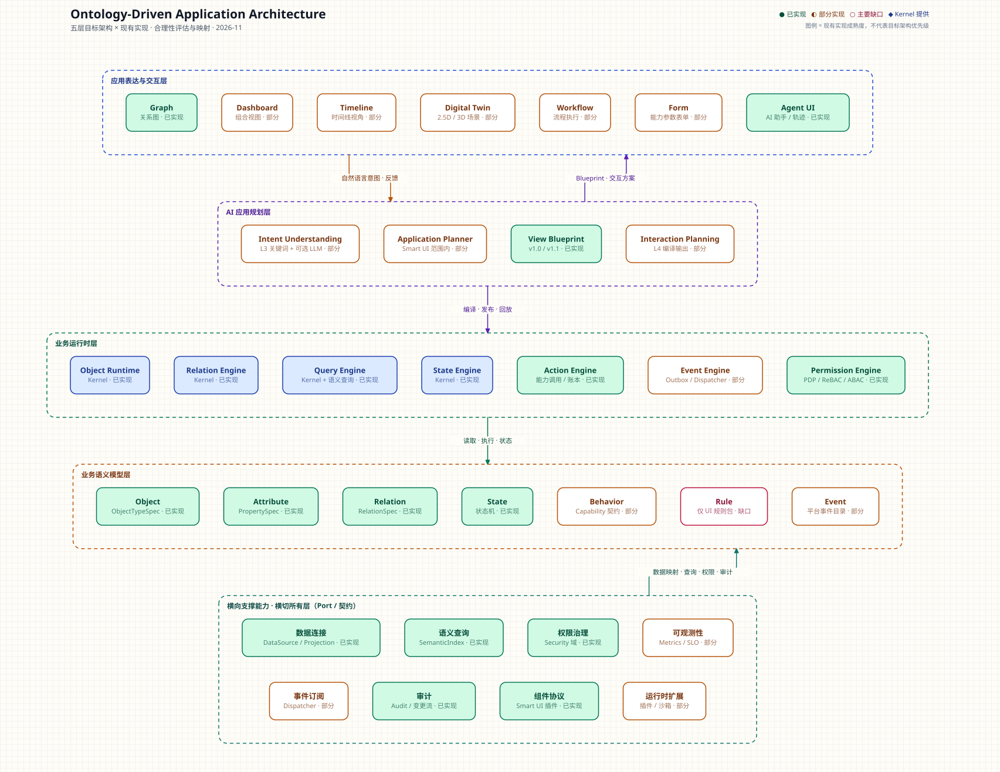

# 本体驱动应用架构：合理性分析与现有实现对照

> 分析对象：五层目标架构（语义模型 / 业务运行时 / 应用表达 / AI 规划 / 横向支撑）
> 对照基线：OntoPlatform 当前仓库实现（v0.3，2026-11）
> 结论：**方向合理，适合作为产品叙事与演进蓝图；若直接当作实施规格，还需要补三类边界契约、一组生产性能力，并把 AI 规划层从“运行时层”改为“设计时生成面”。**



---

## 0. 结论先行

### 0.1 一句话判断

这版架构的最大价值，是第一次把 **“业务世界是什么 → 如何运行 → 如何被看见和操作 → 如何用自然语言生成 → 靠什么横向支撑”** 讲成了一条完整链路，和 OntoPlatform “本体驱动应用”的产品方向高度一致。

但它的最大问题，也藏在同一条链路里：**把“声明”与“执行”、把“设计时生成”与“运行时服务”、把“视图”与“流程/表单/Agent”混在了同一组层里。** 结果是概念上很顺，落到工程边界上会出现重复、空转和职责不清。

### 0.2 三个总体判断

| 判断 | 说明 |
|---|---|
| **分层方向正确** | 语义、运行时、表达、生成、支撑五个关注点真实存在，且与现有 `domain / ports / infrastructure / application` 的划分可以对齐。 |
| **实施规格不足** | `Rule` / `Event` / `Behavior` 在语义层和运行时层重复出现；`AI 规划` 被画成运行时的一层，实际是设计时生成管线；`横向支撑` 是数据面、运行时服务、治理和扩展机制的混合体。 |
| **现有实现更深** | 现有代码在 Kernel 边界、确定性编译、AI 裁决与沙箱、发布回滚、审计/SLO/幂等/对账上，已经比这版架构描述得更具体。目标架构应“补叙事”，不应“重写实现”。 |

这里说的“三类边界”是：**语义声明与运行执行的边界、应用组合与表达面的边界、AI 生成与运行/发布的边界**。它们分别决定 Rule/Event 由谁执行、View/Interaction 由谁消费、生成产物如何进入运行时。

### 0.3 评分（主观，用于讨论而非验收）

| 维度 | 评价 | 理由 |
|---|---|---|
| 对外解释力 | **强（8.5/10）** | 五层一句话能讲清产品全貌，适合官网、方案和路线图。 |
| 分层职责闭合 | **中（6/10）** | Rule/Event/Behavior 跨层重复，AI 规划层定位错位，支撑层过杂。 |
| 与现有实现一致性 | **中偏强（7/10）** | 大部分能力有落点，但没有表达 Kernel/Platform 的防腐败边界。 |
| AI 生成闭环 | **中（6/10）** | 只列了 4 个“顺利路径”步骤，缺裁决、编译、预览、发布、回放、评估。 |
| 生产可运维性 | **中偏弱（5/10）** | 缺租户/工作空间、发布部署、一致性、多租户隔离、AI 成本与可观测性。 |
| 可演进性 | **强（8/10）** | 可以增量补齐，不需要推翻现有 Kernel 或 Smart UI。 |

**综合建议：把它定位为“目标架构叙事 + 演进路线”，不要直接当作“模块清单”。**

---

## 1. 分析口径

- 只分析目标文本中的 **架构合理性**，不评价具体 UI 审美。
- “现有实现”以仓库代码与 `docs/` 设计文档为准，不以 README 宣传语为准。
- 状态口径：
  - **● 已实现**：有明确代码入口，主链路可用。
  - **◐ 部分实现**：有局部/间接实现，或只在某个子域成立。
  - **○ 主要缺口**：没有第一等实现，只有概念或周边能力。
  - **◆ Kernel 提供**：由运行时内核提供，平台通过 Port/ACL 使用。

---

## 2. 为什么说它“合理”：五个真实关注点

### 2.1 它抓住了本体驱动架构的核心分工

| 层 | 回答的问题 | 为什么需要单独一层 |
|---|---|---|
| 业务语义模型 | 业务世界里有什么、彼此怎么连、什么状态算合法 | 这是本体驱动的“事实源”，不能和 UI、流程、权限混在一起。 |
| 业务运行时 | 对象如何读写、关系如何遍历、动作如何执行、状态如何迁移 | 这是“业务操作系统”，需要独立于表达层演进。 |
| 应用表达与交互 | 人如何理解、观察、操作业务 | 同一套本体可以长出图、表、时间线、孪生、表单、Agent。 |
| AI 应用规划 | 自然语言意图如何变成应用结构和交互方案 | 这是生成式入口，决定了“不会建模的人能不能用”。 |
| 横向支撑 | 数据、查询、权限、审计、可观测性、扩展如何复用 | 这些能力不应在每个应用里重新实现。 |

### 2.2 它和现有实现的方向是同源的

现有平台的实际结构是：

```text
interfaces → application → domain
                 ↓
               ports
                 ↓
          infrastructure → Ontology Runtime Kernel
```

领域侧已经有 `workspace / ontology / data / capability / application / intelligence / governance`，并且额外有 `security`、`workflow` 等支撑域。目标架构的五层，基本可以视为对这套领域能力的一次“产品化重述”：

- 语义层 ≈ `domain/ontology` + `domain/capability` 的声明部分；
- 运行时层 ≈ Kernel + `ports/runtime` + `application` 中的执行用例；
- 表达层 ≈ `domain/application` 的 View/Query/Agent + Smart UI；
- AI 规划层 ≈ `application/smartui` + `application/intelligence`；
- 横向支撑 ≈ `data / security / governance` + 平台运维能力。

因此它不是“另一套架构”，而是**同一套能力的更高层叙事**。这是它最大的合理性来源。

### 2.3 它承认了“应用”是多种表达面的组合

传统低代码平台往往把“页面”当成唯一表达，目标架构同时列出 Graph、Dashboard、Timeline、Digital Twin、Workflow、Form、Agent UI，说明它认识到：

- 同一份业务语义，可能需要 **关系视角、统计视角、时间视角、空间视角、流程视角、输入视角、对话视角**；
- 应用不是“一个页面”，而是“一组视角 + 一组动作 + 一组 Agent 入口”。

这和现有 `Application = View / Query / Agent`、Smart UI 的 `perspectives`（identity / relationship / timeline / location / statistics / state / rule / action）是同一思路的扩展。

### 2.4 它把 AI 规划放在了正确的问题域

“自然语言业务意图 → 应用结构 → 交互方案”确实是生成式 BI / 生成式应用的核心问题。现有 Smart UI 的 L0–L5 已经证明这条链路可行：

```text
L0 本体适配 → L1/L2 语义视角能力派生 → L3 规划
→ L4 确定性编译 → L5 隔离渲染
```

目标架构把“意图理解、应用规划、视图蓝图、交互规划”单独列出，方向是对的。问题不在于“该不该有这一层”，而在于“它是不是运行时的一层”。

### 2.5 它把横向能力显式化了

数据连接、语义查询、权限治理、可观测性、事件订阅、审计、组件协议、运行时扩展，确实是每个应用都会重复遇到的问题。把它们显式列为横向能力，比藏在各个业务域里更利于复用和治理。

**但“显式化”不等于“已经收敛”。** 这些能力的所有权、端口和生命周期，才是下一节要讨论的重点。

---

## 3. 逐层分析：合理在哪里，问题在哪里

### 3.1 业务语义模型层：结构清楚，但把“动态语义”混进了静态世界

目标定义：

> Object · Attribute · Relation · State · Behavior · Rule · Event —— 定义业务世界是什么。

#### 合理之处

- Object / Attribute / Relation / State 是典型的**结构语义**，适合作为本体核心。
- 把 State 放进语义层，而不是只放在运行时，符合“状态机是业务规则的一部分”的判断。
- Behavior / Rule / Event 被点名，说明架构意识到“业务世界不只是名词，还有动词和约束”。

#### 主要问题

**问题 1：Behavior / Rule / Event 不是“世界是什么”，而是“世界如何变化”。**

它们更准确的身份是**行为契约 / 约束契约 / 事件契约**，和 Object/Attribute/Relation/State 不在同一个抽象层。把它们平铺在语义层，会导致两个后果：

- 语义层看起来“什么都有”，但无法回答“哪些是结构，哪些是执行语义”；
- 运行时层再出现 State Engine / Action Engine / Event Engine 时，读者不知道 Rule 到底由谁执行。

**问题 2：Rule 没有运行时引擎，是“悬空概念”。**

现有代码里没有通用业务规则引擎。`application/smartui/rules.py` 是 **Smart UI 生成用的规则包**，用于“无模型时按规则选择视图”，不是业务规则引擎。也就是说：

- 目标架构把 Rule 放在语义层；
- 运行时层没有 Rule Engine；
- 现有实现只有 UI 规则包。

三者对不上。Rule 会成为“定义了但没人执行”的层。

**问题 3：Event 在现有实现中是“平台生命周期事件”，不是“本体事件模型”。**

`application/events.py` 有事件目录、outbox、Dispatcher、重试和死信，这是很扎实的**领域事件基础设施**；但它的事件类型是 `workspace.created`、`ontology.published`、`capability.invoked` 这类平台事件，不是“业务本体声明的领域事件”（例如“车辆驶入收费站”“支付完成”）。

因此 Event 的语义层和运行时层都没有闭环：

- 语义层没有事件 schema / payload / 版本；
- 运行时层有 outbox，但没有“业务事件定义 → 订阅 → 处理”的通用链路。

**问题 4：缺少 Identity / Constraint / Vocabulary。**

现有 `domain/ontology/model.py` 里，`ObjectTypeSpec` 有 `identity`、`category`、属性 facets，`RelationSpec` 有 `cardinality`、`inverse`，`Ontology` 有 `vocabulary`。这些是本体能否被查询、校验、编译的关键。

目标文本只列了 Attribute，没有明确 Identity / Constraint / Vocabulary。它们不是“实现细节”，而是语义模型的一等公民。

#### 建议

- 把这一层改名为 **“业务语义与契约层”**，并明确两个子层：
  - **结构语义**：Object / Attribute / Relation / State / Identity / Constraint / Vocabulary；
  - **行为契约**：Behavior / Rule / Event（只做声明，不负责执行）。
- 每个契约都要有 schema、版本、校验器和 owner。
- Rule / Event 必须配对运行时引擎，否则不要放进目标架构的“已定义”部分。

**判断：方向对，但需要“结构 / 行为”二分；否则语义层会变成概念仓库。**

---

### 3.2 业务运行时层：最接近现有实现，但缺 Rule / Workflow / 一致性

目标定义：

> Object Runtime · Relation Engine · Query Engine · State Engine · Action Engine · Event Engine · Permission Engine —— 定义业务如何运行，以及能够做什么。

#### 合理之处

这七项几乎就是现有平台运行时的能力清单：

- Object / Relation / Query / State：由 Kernel 提供，平台通过 `ports/runtime.py` 的 `RuntimeGateway` 访问；
- Action：由 `Capability` 编译为 Kernel function，通过 `invoke` 执行；
- Event：由 `application/events.py` 的 outbox + Dispatcher 提供；
- Permission：由 `application/security` 的 PDP、角色、ReBAC、ABAC、义务（obligation）提供。

这是五层里和现有代码最贴合的一层。

#### 主要问题

**问题 1：没有 Rule Engine，语义层的 Rule 无处执行。**

如果 Rule 是语义层的一等概念，运行时必须有：

- 规则解析 / 校验；
- 优先级与冲突解决；
- 规则求值（读取对象/关系/状态）；
- 干跑（dry-run）与解释；
- 规则命中审计。

现有只有 Smart UI 规则包，不具备这些能力。

**问题 2：没有 Workflow Engine 的显式位置。**

现有 `domain/workflow` + `application/workflow_usecases.py` 有流程定义与执行，但目标架构把 Workflow 放在表达层。这会造成一个错觉：Workflow 只是“界面”，而不是运行时能力。

更合理的划分是：

- 运行时层：Workflow Engine（执行、状态、补偿、超时）；
- 表达层：Workflow 的建模/运行界面。

**问题 3：缺一致性语义。**

业务运行时不是“对象 CRUD 的集合”，还必须回答：

- 一次动作是否事务性？
- 幂等键如何定义？
- 事件是否与聚合同事务写入（outbox）？
- 失败如何补偿/重试/对账？
- 读写一致性边界在哪里？

现有实现其实有 `execution_ledger`、`idempotency`、outbox、reconciliation、controller，但这些没有进入目标架构。目标架构缺了“运行时可靠性”这一整块。

**问题 4：Query Engine 与横向“语义查询”重复，Permission Engine 与横向“权限治理”重复。**

- Query Engine 是执行器；语义查询是查询语言/编译器。两者可以并存，但必须标明“谁执行、谁编译”。
- Permission Engine 是决策点；权限治理是策略生命周期、审批、审计。两者也可以并存，但目标架构没有说明边界，读者会以为是两套权限系统。

**问题 5：Object Runtime 与 State Engine 的边界不清。**

对象存储、对象生命周期、状态机迁移三者关系需要明确：

- Object Runtime 负责对象身份、读写、引用完整性；
- State Engine 负责状态机定义、迁移合法性、迁移副作用；
- 两者共享同一份对象状态，但职责不同。

#### 建议

- 明确写成 **“Kernel Runtime + Platform Runtime”** 两层实现，而不是一个模糊的“业务运行时”：
  - Kernel Runtime：Object / Relation / Query / State；
  - Platform Runtime：Action / Rule / Event / Workflow / Permission。
- 补 `Rule Engine`、`Workflow Engine`、`Consistency / Transaction / Idempotency`。
- 把 `Query Engine` 和“语义查询”标成 “执行 vs 编译”，把 `Permission Engine` 和“权限治理”标成 “决策 vs 治理”。

**判断：能力清单基本正确，但缺 Rule/Workflow/一致性，且没有表达 Kernel/Platform 边界。**

---

### 3.3 应用表达与交互层：覆盖面好，但抽象层级不齐

目标定义：

> Graph · Dashboard · Timeline · Digital Twin · Workflow · Form · Agent UI —— 定义业务如何被理解、观察和操作。

#### 合理之处

- Graph / Dashboard / Timeline / Digital Twin 对应“观察和理解”的不同视角；
- Workflow / Form 对应“操作”；
- Agent UI 对应“对话式操作”；
- 这比只列“页面/组件”更接近业务用户的真实工作方式。

现有 Smart UI 也有类似视角：identity / relationship / timeline / location / statistics / state / rule / action；内置 renderer 覆盖 table / chart / GIS / 2.5D / 3D。两者可以互相映射。

#### 主要问题

**问题 1：七种表达不在同一个抽象层级。**

| 类型 | 本质 | 需要的契约 |
|---|---|---|
| Graph / Dashboard / Timeline / Digital Twin | **看**（View） | 数据绑定、布局、交互、权限裁剪 |
| Workflow | **流程**（Process） | 流程定义、状态、补偿、人机任务 |
| Form | **输入**（Input） | 字段 schema、校验、联动、提交动作 |
| Agent UI | **对话/代理**（Agent） | 意图、工具、上下文、审批、可解释性 |

把它们平铺成一层，会导致“组件协议”无法统一：一个 Graph 组件和一个 Workflow 编辑器，生命周期、数据契约、权限模型完全不同。

**问题 2：Digital Twin 被过度承诺。**

现有 `Scene25D` / `Twin3D` 是空间场景渲染，能按业务指标拉伸对象、联动选择，但还没有：

- 物理/业务模型的实时同步；
- 遥测/传感器接入；
- 仿真、预测、反事实；
- 与真实世界状态的双向校准。

如果目标架构把“3D 场景”叫 Digital Twin，会拉高预期。更准确的命名是 **Spatial / 3D Scene**；只有具备“模型 + 实时状态 + 仿真”三者，才叫 Digital Twin。

**问题 3：缺少统一的 View / Interaction 契约。**

现有应用模型 `domain/application/model.py` 的 View 只有 `table | card | chart | map`，而 Smart UI 的 renderer 更丰富。两者没有统一到一个 `ViewSpec` / `InteractionSpec`，导致：

- 应用内声明式视图与 AI 生成视图是两套；
- Dashboard / Timeline / Form 没有通用 schema；
- 组件协议只能在 Smart UI 子域内成立。

**问题 4：Workflow / Form / Agent UI 的运行逻辑被放在表达层。**

它们都有“运行态”：

- Workflow 需要执行引擎、超时、补偿；
- Form 需要提交动作、幂等、权限；
- Agent UI 需要工具调用、审批、上下文管理。

表达层应只保留“界面与交互协议”，运行逻辑归运行时/生成面。

#### 建议

- 拆成两个子层：
  - **观察层（View Surfaces）**：Graph / Dashboard / Timeline / Spatial / Twin；
  - **交互层（Interaction Surfaces）**：Workflow / Form / Agent UI。
- 定义 `ViewSpec`（数据、视角、布局、权限）和 `InteractionSpec`（动作、输入、流程、审批）。
- 只有具备实时状态同步与仿真能力时，才使用 Digital Twin 一词。

**判断：覆盖面对，但需要“看/做/对话”三分，并补统一契约。**

---

### 3.4 AI 应用规划层：方向对，但不该是“运行时的一层”

目标定义：

> Intent Understanding · Application Planner · View Blueprint · Interaction Planning —— 将自然语言业务意图转换成应用结构和交互方案。

#### 合理之处

- 它把“生成应用”当成一个独立问题，而不是 UI 的附属功能；
- 四个步骤（理解意图、规划应用、视图蓝图、交互规划）覆盖了从语言到结构的核心转换；
- 与现有 Smart UI 的 L3 规划、L4 编译可以对应。

#### 主要问题

**问题 1：这是设计时生成管线，不是运行时层。**

AI 规划发生在“用户提出需求 → 生成应用”的时刻，产物是 Blueprint / 编译产物 / 应用快照；它不参与每次业务请求的运行时链路。把它放在运行时之上，会带来两个误导：

- 读者以为每个请求都要经过 AI 规划；
- 实现者容易把“规划结果”直接当“运行时状态”，绕过裁决与编译。

更准确的定位是 **“生成面 / 应用编译器 / AI Studio”**，与运行时是“设计时 → 运行时”的关系，而不是上下层。

**问题 2：只列了顺利路径，缺闭环。**

一个可生产的 AI 规划层至少需要：

```text
意图澄清 → 上下文装配 → 候选规划 → 约束求解
→ 语义/权限/能力/布局裁决 → 确定性编译 → 沙箱预览
→ 人工确认 → 发布 → 回放/评估 → 失败回退
```

目标文本只描述了这条链路的前半段。现有 Smart UI 反而更完整：

- 上下文包（L0–L2 + focus）；
- LLM 提议 Blueprint；
- adjudicator / sanitizer 裁决；
- 确定性 L4 编译；
- L5 隔离渲染；
- 规则模式兜底；
- 插件化、审计、program hash；
- 回放（检测锁漂移 + 用历史 Blueprint 重编译）。

**问题 3：Intent Understanding 不能只靠 LLM。**

业务意图理解需要本体词汇、权限边界、数据画像、能力可用性共同约束。现有 L3 是关键词/确定性规划，LLM 只是可选提议器；这比“纯 LLM 理解意图”更可控。目标架构应明确“确定性约束 + 模型提议”的混合模式。

**问题 4：Application Planner 的现有范围只到 Smart UI。**

现有 `plan_application` / `compile_smart_ui` 规划的是 Smart UI 的视图集合与动作，不是完整的“应用结构”（views + queries + workflows + agents + permissions + data bindings）。因此目标架构里的 Application Planner 在现有实现中只能算 **部分实现**。

**问题 5：Interaction Planning 没有独立产物。**

现有 L4 编译器会把 Blueprint 编译成 OpenUI 程序，动作、工具闭包、视图都在程序里，但没有独立的“交互方案”对象。目标架构若把 Interaction Planning 单列，需要定义它的输出契约，否则只是 L4 的别名。

#### 建议

- 把这一层改名为 **“AI 生成面（设计时）”**，明确它不参与运行时请求。
- 补全闭环：澄清、上下文、裁决、编译、预览、发布、回放、评估、回退。
- 明确“确定性约束优先，模型提议其次”。
- 把 Application Planner 从“Smart UI 视图规划”提升为“ApplicationSpec 规划”，但不要一步到位；先定义 `ApplicationSpec` 契约。

**判断：问题域正确，但层位错误、闭环不足；现有实现比目标描述更强。**

---

### 3.5 横向支撑能力：需要拆分，否则会变成“杂物层”

目标定义：

> 数据连接 · 语义查询 · 权限治理 · 可观测性 · 事件订阅 · 审计 · 组件协议 · 运行时扩展。

#### 合理之处

这八项确实是跨应用复用的能力，且现有实现大多有落点：

- 数据连接：DataSource / Mapping / Projection / SemanticDelta；
- 语义查询：`SemanticIndex` + Kernel `find/related`；
- 权限治理：PDP + 角色 + ReBAC/ABAC + 审批；
- 可观测性：metrics / SLO / controller / execution ledger；
- 事件订阅：outbox + Dispatcher；
- 审计：append-only audit + `observe_changes`；
- 组件协议：Smart UI manifest / contract / renderer；
- 运行时扩展：插件 host、签名、opt-in。

#### 主要问题

**问题 1：它混合了四种不同性质的东西。**

| 类别 | 包含 | 应该归属 |
|---|---|---|
| 数据面 | 数据连接、语义查询 | 数据/查询平面 |
| 运行时服务 | 事件订阅、权限执行 | 运行时层 |
| 治理面 | 权限治理、审计、可观测性 | 治理平面 |
| 扩展面 | 组件协议、运行时扩展 | 扩展/插件平面 |

把它们放在一个“横向支撑层”里，会掩盖所有权和生命周期差异。

**问题 2：与运行时层重复。**

- `语义查询` vs `Query Engine`；
- `事件订阅` vs `Event Engine`；
- `权限治理` vs `Permission Engine`。

重复本身不一定是错，但必须写成“编译 vs 执行”“策略 vs 决策”“引擎 vs 订阅”的关系，否则会变成两套实现。

**问题 3：缺关键生产性能力。**

目标文本没有提到：

- 工作空间 / 租户隔离；
- 生命周期 / 发布 / 部署 / 回滚 / 灰度；
- Schema 演进与迁移；
- 能力打包 / 注册 / 版本；
- 投影同步 / 对账 / 数据血缘；
- 幂等 / 事务 / 补偿；
- 密钥 / 凭据 / 数据脱敏；
- AI 生成的成本、延迟、评测、审计；
- 插件隔离 / SBOM / 依赖校验；
- 跨层 trace 与 SLO。

这些不是“支撑层的可选加分项”，而是从 Demo 到生产的分水岭。现有实现已经在 `releases.py`、`controller.py`、`slo.py`、`metrics.py`、`security/` 里做了不少，目标架构反而没有体现。

**问题 4：组件协议不是“横向支撑”，而是表达层的扩展契约。**

组件协议解决的是“新视图/新交互如何注册、渲染、鉴权、版本化”，它属于表达/扩展面。把它放在横向支撑，会让人误以为它和数据库连接是同一类能力。

#### 建议

拆成三个平面：

1. **数据面**：数据连接、投影/同步、语义查询、血缘、对账；
2. **治理面**：租户/工作空间、权限策略、审计、发布/部署、可观测性/SLO、成本；
3. **扩展面**：组件协议、插件 host、沙箱、打包/签名/版本。

每个平面都要有：

- 明确的 Port / Contract；
- 一个 owner；
- 生命周期与版本策略；
- 失败模式与可观测指标。

**判断：清单有价值，但必须拆分；否则“横向”会变成“什么都往里放”。**

---

## 4. 与现有实现的逐项映射

> 状态：● 已实现 / ◐ 部分实现 / ○ 主要缺口 / ◆ Kernel 提供。
> 说明：状态按“目标要素在现有代码中的第一等落点”判断，不按宣传口径。

### 4.1 语义模型层

| 目标要素 | 现有落点 | 状态 | 说明 |
|---|---|---|---|
| Object | [`domain/ontology/model.py`](../../src/onto_platform/domain/ontology/model.py) `ObjectTypeSpec` | ● | 对象类型、属性、身份、分类齐全。 |
| Attribute | 同上 `PropertySpec` + facets | ● | 支持类型、可空、枚举、时间等 facet。 |
| Relation | 同上 `RelationSpec` | ● | 支持 source/target、cardinality、inverse。 |
| State | 同上 `state_machine` + Kernel | ● | 状态机随对象类型编译进 Kernel schema。 |
| Behavior | [`domain/capability/model.py`](../../src/onto_platform/domain/capability/model.py) `Capability` | ◐ | Capability 已承担主要行为契约，但没有抽象成语义层 `Behavior`。 |
| Rule | [`application/smartui/rules.py`](../../src/onto_platform/application/smartui/rules.py) | ○ | 只有 Smart UI 生成规则包，没有通用业务规则引擎。 |
| Event | [`application/events.py`](../../src/onto_platform/application/events.py) | ◐ | 有平台事件目录/outbox，但不是本体事件 schema。 |

**补充**：现有实现还有目标文本未列的 `identity`、`category`、`cardinality`、`inverse`、`vocabulary`、属性 facets，这些应被视为语义层的一部分，而不是实现细节。

### 4.2 业务运行时层

| 目标要素 | 现有落点 | 状态 | 说明 |
|---|---|---|---|
| Object Runtime | [`ports/runtime.py`](../../src/onto_platform/ports/runtime.py) + [`infrastructure/runtime/kernel_gateway.py`](../../src/onto_platform/infrastructure/runtime/kernel_gateway.py) | ◆ | Kernel 提供 describe/get/find。 |
| Relation Engine | 同上 `related` | ◆ | 支持出边/入边遍历。 |
| Query Engine | 同上 `find` + [`domain/intelligence/model.py`](../../src/onto_platform/domain/intelligence/model.py) `SemanticIndex` | ◆/● | Kernel 执行过滤，平台做语义索引/问答。 |
| State Engine | Kernel schema `state_machine` | ◆ | 状态迁移由 Kernel 执行。 |
| Action Engine | [`domain/capability/model.py`](../../src/onto_platform/domain/capability/model.py) + `invoke` + 执行账本 | ● | 能力编译为 Kernel function，支持幂等/审计。 |
| Event Engine | [`application/events.py`](../../src/onto_platform/application/events.py) | ◐ | 有 outbox/Dispatcher/重试/死信，但缺业务事件定义与通用订阅 API。 |
| Permission Engine | [`application/security/pdp.py`](../../src/onto_platform/application/security/pdp.py) | ● | PDP 顺序固定，支持角色、ReBAC、ABAC、义务。 |

**缺口**：Rule Engine、Workflow Engine 的运行时位置、一致性/事务语义。

### 4.3 应用表达与交互层

| 目标要素 | 现有落点 | 状态 | 说明 |
|---|---|---|---|
| Graph | `frontend` 关系图 + Smart UI relationship 视角 | ● | 已有关系图与联动。 |
| Dashboard | [`domain/application/model.py`](../../src/onto_platform/domain/application/model.py) `View` + Smart UI 多视角 | ◐ | 有 table/card/chart/map 和多视角，但没有 Dashboard 组合契约。 |
| Timeline | Smart UI `timeline` 视角 + 变更流 | ◐ | 有时间线视角，缺通用时间线视图/事件时间轴。 |
| Digital Twin | [`application/smartui/views/spatial.py`](../../src/onto_platform/application/smartui/views/spatial.py) `Scene25D` / `Twin3D` | ◐ | 是空间场景渲染，不是带实时同步/仿真的孪生。 |
| Workflow | [`domain/workflow/model.py`](../../src/onto_platform/domain/workflow/model.py) + workflow usecases | ◐ | 有流程定义/执行，但主要是能力编排，不是通用流程表达。 |
| Form | 能力输入 schema + 控制台动作表单 | ◐ | 有参数化表单，缺通用表单 schema/联动/多步。 |
| Agent UI | `frontend` AI 控制台 + [`application/intelligence_usecases.py`](../../src/onto_platform/application/intelligence_usecases.py) | ● | 有对话、运行轨迹、工具调用。 |

**缺口**：统一 `ViewSpec` / `InteractionSpec`；Dashboard / Timeline / Form 的通用契约。

### 4.4 AI 应用规划层

| 目标要素 | 现有落点 | 状态 | 说明 |
|---|---|---|---|
| Intent Understanding | [`application/smartui/bridge.py`](../../src/onto_platform/application/smartui/bridge.py) L3 + [`generators.py`](../../src/onto_platform/application/smartui/generators.py) | ◐ | 确定性关键词规划为主，LLM 为可选提议器。 |
| Application Planner | `plan_application` / `compile_smart_ui` | ◐ | 只规划 Smart UI 的视图/动作，不是完整应用结构。 |
| View Blueprint | [`application/smartui/contracts.py`](../../src/onto_platform/application/smartui/contracts.py) / Studio | ● | Blueprint v1.0/v1.1 有 schema、裁决、编译。 |
| Interaction Planning | L4 编译器输出 OpenUI 程序 | ◐ | 动作/工具闭包在编译产物里，没有独立交互方案对象。 |

**现有实现更强的地方**：adjudication / sanitizer / 确定性编译 / 沙箱 / 插件化 / 回放 / 规则模式。这些应保留，不应为了贴合目标架构而删掉。

### 4.5 横向支撑能力

| 目标要素 | 现有落点 | 状态 | 说明 |
|---|---|---|---|
| 数据连接 | [`domain/data`](../../src/onto_platform/domain/data) + DataSource/Projection/SemanticDelta | ● | 有数据源、映射、投影、语义增量。 |
| 语义查询 | `SemanticIndex` + `AskOntology` + Kernel `find/related` | ● | 有确定性语义索引与问答。 |
| 权限治理 | [`application/security`](../../src/onto_platform/application/security) | ● | PDP、角色、ReBAC/ABAC、审批/委托。 |
| 可观测性 | [`application/metrics.py`](../../src/onto_platform/application/metrics.py)、[`slo.py`](../../src/onto_platform/application/slo.py)、[`controller.py`](../../src/onto_platform/application/controller.py) | ◐ | 有指标/SLO/控制器，缺跨层 trace 与 AI 生成观测。 |
| 事件订阅 | `Dispatcher.subscribe` | ◐ | 进程内订阅为主，缺对外事件订阅 API/过滤/转换。 |
| 审计 | 审计服务 + `observe_changes` | ● | append-only + 变更流。 |
| 组件协议 | [`application/smartui/contracts.py`](../../src/onto_platform/application/smartui/contracts.py) + manifests/renderers | ● | 19 个内置 manifest，插件化契约清晰。 |
| 运行时扩展 | plugin host + 签名 + opt-in | ◐ | 有插件机制，缺进程隔离/资源限额/SBOM。 |

**缺口**：租户/工作空间、发布部署、Schema 演进、能力打包、投影对账、幂等/事务、密钥、AI 成本/评测、插件隔离。

---

## 5. 异同点总结

### 5.1 相同点

1. **都以本体为事实源**：对象、属性、关系、状态是业务描述的核心。
2. **都承认运行时需要独立抽象**：对象/关系/查询/状态/动作/事件/权限不能被 UI 吞掉。
3. **都把“应用”视为多视角组合**：不是单一页面，而是多种观察与操作方式。
4. **都希望用自然语言降低应用构建门槛**。
5. **都强调权限与数据连接**，不是纯前端生成器。

### 5.2 关键差异

| 维度 | 目标架构 | 现有实现 | 判断 |
|---|---|---|---|
| 组织方式 | **按层组织**，强调产品叙事 | **按领域 + Kernel 组织**，强调边界 | 目标更适合沟通，现有更适合落地。 |
| 语义完整性 | 显式列 Behavior/Rule/Event | 结构语义深，行为/规则/事件弱 | 目标更完整，现有更偏结构。 |
| 运行时边界 | 一个“业务运行时层” | Kernel vs Platform，经 ACL/Port | 现有边界更清晰，目标需补。 |
| 表达层 | 七种表达并列 | Graph + Smart UI renderers + 应用 View | 目标更全，现有更具体。 |
| AI 规划 | 线性四步 | L0–L5 + 裁决 + 编译 + 沙箱 + 回放 | 现有更深，目标更像摘要。 |
| Rule/Event | 一等概念 | 规则包/平台事件，缺通用引擎 | 目标更先进，现有有缺口。 |
| 生命周期/发布 | 未提及 | Release/Deployment/Rollback/Canary | 现有明显更强。 |
| 确定性/可回放 | 未提及 | 确定性编译器 + program hash + 回放 | 现有明显更强。 |
| 一致性与可靠性 | 未提及 | 幂等/账本/outbox/对账/controller | 现有明显更强。 |
| 扩展隔离 | 提到运行时扩展 | 插件 host + 签名，未进程隔离 | 两者都不完整，现有更具体。 |
| 多租户 | 未提及 | `TenantContext`/工作空间边界 | 现有更强，目标需补。 |

### 5.3 一个关键判断

**目标架构不是现有实现的“上位替代”，而是它的“产品化叙事 + 缺口清单”。**

- 如果按目标架构重写现有代码，会丢掉 Kernel 边界、确定性编译、发布治理等真正的护城河；
- 如果只守现有实现，会缺少 Rule/Event/Behavior 的一等语义、统一表达契约和完整 AI 生成闭环。

正确做法是：**保留现有实现作为运行时/治理底座，用目标架构补齐语义层、表达层和生成面的缺口。**

---

## 6. 成熟度矩阵

按目标文本点名的 **33 个能力** 计数（同一能力跨层出现时分别计数，用于看覆盖，不代表代码量）：

| 层 | ● 已实现 | ◐ 部分实现 | ○ 主要缺口 | 判断 |
|---|---:|---:|---:|---|
| 业务语义模型 | 4 | 2 | 1 | 结构强，行为/规则/事件弱。 |
| 业务运行时 | 6 | 1 | 0 | 与现有实现最贴合；缺 Rule/Workflow/一致性。 |
| 应用表达与交互 | 2 | 5 | 0 | 覆盖广，缺统一契约；Digital Twin 过度承诺。 |
| AI 应用规划 | 1 | 3 | 0 | Blueprint 强，意图/应用规划/交互规划弱。 |
| 横向支撑 | 5 | 3 | 0 | 数据/权限/审计强，可观测/订阅/扩展弱。 |
| **合计** | **18** | **14** | **1** | **约 55% 已实现、42% 部分、3% 缺口。** |

### 6.1 最重要的五个缺口

| 缺口 | 影响 | 优先级 |
|---|---|---|
| 业务规则引擎 | Rule 只是概念，无法执行/解释/审计 | **P0/P1** |
| 业务事件契约与订阅 | Event 只有平台 outbox，无法表达业务事件 | **P1** |
| 统一 View / Interaction 契约 | Dashboard/Timeline/Form/Graph 各自为战 | **P1** |
| AI 生成闭环（裁决/编译/发布/回放/评估） | 目标描述只覆盖顺利路径 | **P1** |
| 发布/租户/一致性/扩展隔离 | 从 Demo 到生产的关键 | **P2** |

---

## 7. 建议的修订架构：五层叙事 + 三个平面

不建议推翻五层叙事，而是把它改成 **“五层用于沟通，三个平面用于实施”**。

### 7.1 目标形态

```text
┌──────────────────────────────────────────────────────────────┐
│ 体验面                                                       │
│ View Surfaces             Interaction Surfaces               │
│ Graph / Dashboard /       Workflow / Form / Agent UI         │
│ Timeline / Spatial-Twin                                      │
└──────────────────────────────┬───────────────────────────────┘
                               │ ViewSpec / InteractionSpec
┌──────────────────────────────▼───────────────────────────────┐
│ 应用编排面                                                   │
│ ApplicationSpec = View + Query + Workflow + Agent            │
│                  + CapabilityBinding + PermissionBinding     │
└──────────────────────────────┬───────────────────────────────┘
                               │ RuntimeGateway
┌──────────────────────────────▼───────────────────────────────┐
│ 运行面                                                       │
│ Kernel Runtime：Object / Relation / Query / State            │
│ Platform Runtime：Action / Rule / Event / Workflow / Permission│
└──────────────────────────────┬───────────────────────────────┘
                               │ 语义契约
┌──────────────────────────────▼───────────────────────────────┐
│ 语义面                                                       │
│ 结构语义：Object / Attribute / Relation / State / Identity   │
│ 行为契约：Behavior / Rule / Event                            │
└──────────────────────────────────────────────────────────────┘
                               ▲
        ┌──────────────────────┴──────────────────────┐
        │ 生成面（设计时，不在请求链路上）              │
        │ Intent → Context → Plan → Adjudicate →      │
        │ Compile → Preview → Publish → Replay → Eval │
        └──────────────────────┬──────────────────────┘
                               ▲
        ┌──────────────────────┴──────────────────────┐
        │ 治理 / 数据 / 扩展面（横切）                  │
        │ Tenant / Release / Data Projection / Audit / │
        │ Observability / Security / Plugin Sandbox    │
        └──────────────────────────────────────────────┘
```

### 7.2 与目标文本的对应关系

| 目标文本 | 建议调整 |
|---|---|
| 业务语义模型层 | 保留，拆成“结构语义 + 行为契约”；补 Identity / Constraint / Vocabulary。 |
| 业务运行时层 | 保留，明确 Kernel Runtime / Platform Runtime；补 Rule / Workflow / 一致性。 |
| 应用表达与交互层 | 保留，拆成“观察面 / 交互面”；补 ViewSpec / InteractionSpec。 |
| AI 应用规划层 | **改为“生成面”**，明确设计时；补裁决/编译/预览/发布/回放/评估。 |
| 横向支撑能力 | **拆成数据面 / 治理面 / 扩展面**；去重，明确 owner。 |

### 7.3 需要新增的契约

| 契约 | 作用 | 现状 |
|---|---|---|
| `OntologySchema` | 结构语义的编译产物 | 已有 `OntologyCompiler` 输出。 |
| `CapabilityContract` | 行为/动作的输入输出与权限 | 已有 `Capability`。 |
| `RuleContract` | 规则声明、优先级、冲突、解释 | **缺**。 |
| `EventContract` | 事件 schema、版本、payload、订阅 | **部分**（平台事件目录）。 |
| `RuntimeGateway` | 运行时五原语 | 已有。 |
| `ApplicationSpec` | 应用组合（视图/查询/流程/Agent/能力/权限） | 已有 `Application`，但表达力有限。 |
| `ViewSpec` | 视图数据绑定、布局、权限裁剪 | **缺统一版**。 |
| `InteractionSpec` | 动作、输入、流程、审批 | **缺**。 |
| `Blueprint / CompiledProgram / BuildManifest` | AI 生成产物与可回放性 | 已有 Smart UI 版。 |
| `Release / Deployment` | 发布、回滚、灰度、schema 指纹 | 已有。 |
| `PolicyDecision` | 权限决策与义务 | 已有。 |
| `ComponentManifest` | 组件注册、版本、权限、渲染 | 已有 Smart UI 版。 |

---

## 8. 落地路线

### P0：统一语言与边界（1–2 周，不改代码）

1. 把本文作为架构 ADR 放进 `docs/analysis/`，明确“五层叙事 + 三个平面”。
2. 为每层/每个平面指定 owner，禁止“一个能力两个 owner”。
3. 统一“声明 vs 执行”的写法：
   - 语义层只声明 Rule/Event/Behavior；
   - 运行时层负责执行；
   - 表达层只消费 View/Interaction 契约。
4. 把 `OntologySchema`、`CapabilityContract`、`RuntimeGateway`、`ApplicationSpec`、`Release` 定为 canonical contracts。
5. 补一张“目标能力 ↔ 代码入口”的映射表（本文第 4 节可直接作为初版）。

### P1：补齐语义与运行时缺口（2–4 周）

1. **RuleContract + Rule Engine**
   - 支持声明、校验、优先级、冲突、dry-run、解释、审计。
   - 先做“状态/权限/数据完整性”三类高频规则，不要一开始做通用规则语言。
2. **EventContract + 订阅 API**
   - 复用现有 outbox/Dispatcher；
   - 补事件 schema、版本、过滤、转换、重试、死信、对外订阅。
3. **BehaviorContract**
   - 把 Capability 的输入/输出/权限/幂等/超时正式化为行为契约。
4. **ApplicationSpec / ViewSpec / InteractionSpec**
   - 先统一 Smart UI 与声明式 View；
   - 再加 Dashboard / Timeline / Form 的通用 schema。
5. **AI 生成闭环**
   - 补意图澄清、上下文装配、裁决、预览、发布、回放、评估；
   - 明确“模型不可用 → 确定性规划兜底”。

### P2：生产化与平台化（1–2 个月）

1. 把 Release / Deployment / Schema 演进接入应用生命周期。
2. 补租户/工作空间隔离、数据脱敏、密钥管理。
3. 补跨层 trace、AI 生成成本/延迟/质量观测。
4. 补插件进程隔离、资源限额、SBOM、依赖校验。
5. 把本文 SVG 的生成脚本纳入仓库，保证架构图与文档同源。

---

## 9. 验收标准与风险

### 9.1 验收标准

- [ ] 五层中的每个能力都有 owner、契约、代码入口。
- [ ] Rule / Event / Behavior 能“声明 → 校验 → 执行 → 观测”，不是悬空概念。
- [ ] AI 生成有完整 trace：`intent → blueprint → compiled → program hash → publish → replay`。
- [ ] 任何模型输出都不能绕过裁决与确定性编译。
- [ ] 所有表达面都注册到统一 ViewSpec / InteractionSpec。
- [ ] “Digital Twin” 只有在具备实时状态同步与仿真时才使用，否则改称 Spatial/3D Scene。
- [ ] 架构文档与 SVG 可重复生成，SVG audit 通过。

### 9.2 主要风险

| 风险 | 表现 | 对策 |
|---|---|---|
| 过度抽象 | 为每个名词造一个 Engine，没人用 | 先补高频规则/事件，再抽象。 |
| 重复实现 | Query Engine 与语义查询、Permission Engine 与权限治理各做一套 | 明确“编译 vs 执行”“策略 vs 决策”。 |
| AI 绕过治理 | 规划器直接写状态/发动作 | 只允许产出 Blueprint，执行必须走 RuntimeGateway + PDP。 |
| Digital Twin 过度承诺 | 3D 场景被当成孪生 | 命名降级 + 明确能力边界。 |
| 支撑层杂物化 | 新能力都往“横向支撑”塞 | 三个平面 + owner + 端口。 |
| 重写冲动 | 为了贴合五层推翻 Kernel | 保留 Kernel/Platform 边界，增量补齐。 |

---

## 10. 证据索引

### 代码

- 语义模型：[`domain/ontology/model.py`](../../src/onto_platform/domain/ontology/model.py)
- 本体编译（ACL）：[`domain/ontology/compiler.py`](../../src/onto_platform/domain/ontology/compiler.py)
- 能力模型：[`domain/capability/model.py`](../../src/onto_platform/domain/capability/model.py)
- 应用模型：[`domain/application/model.py`](../../src/onto_platform/domain/application/model.py)
- 运行时 Port：[`ports/runtime.py`](../../src/onto_platform/ports/runtime.py)
- Kernel 网关：[`infrastructure/runtime/kernel_gateway.py`](../../src/onto_platform/infrastructure/runtime/kernel_gateway.py)
- 领域事件/Outbox：[`application/events.py`](../../src/onto_platform/application/events.py)
- 权限 PDP：[`application/security/pdp.py`](../../src/onto_platform/application/security/pdp.py)
- Smart UI Studio：[`application/smartui/studio.py`](../../src/onto_platform/application/smartui/studio.py)
- Smart UI 编译桥：[`application/smartui/bridge.py`](../../src/onto_platform/application/smartui/bridge.py)
- Smart UI 内置插件：[`application/smartui/builtin.py`](../../src/onto_platform/application/smartui/builtin.py)
- 空间/孪生 renderer：[`application/smartui/views/spatial.py`](../../src/onto_platform/application/smartui/views/spatial.py)
- 发布/部署：[`application/releases.py`](../../src/onto_platform/application/releases.py)
- 控制器：[`application/controller.py`](../../src/onto_platform/application/controller.py)
- SLO：[`application/slo.py`](../../src/onto_platform/application/slo.py)
- 指标：[`application/metrics.py`](../../src/onto_platform/application/metrics.py)

### 文档

- 现有总览：[`README.md`](../../README.md)
- Smart UI LLM 生成：[`docs/smart-ui-llm-generation.md`](../smart-ui-llm-generation.md)
- Smart UI 插件化：[`docs/design/llm-smart-ui/pluginization.md`](../design/llm-smart-ui/pluginization.md)
- 规则驱动生成：[`docs/design/llm-smart-ui/rule-driven-generation.md`](../design/llm-smart-ui/rule-driven-generation.md)
- 权限模型：[`docs/design/security/permission-model.md`](../design/security/permission-model.md)
- 标准插件架构：[`docs/standards-plugin-architecture.md`](../standards-plugin-architecture.md)
- v0.3 进度：[`docs/progress-v0.3.md`](../progress-v0.3.md)

---

## 附：本文与配套图的关系

- 本文负责**论证、映射、缺口与路线**；
- 配套 SVG 负责**一页看懂五层目标与现有实现的成熟度**；
- 图中颜色只表示“现有实现成熟度”，不表示目标架构优先级；
- 图中 `◆ Kernel 提供` 表示该能力由运行时内核提供，平台通过 Port/ACL 使用，而不是平台重新实现。
