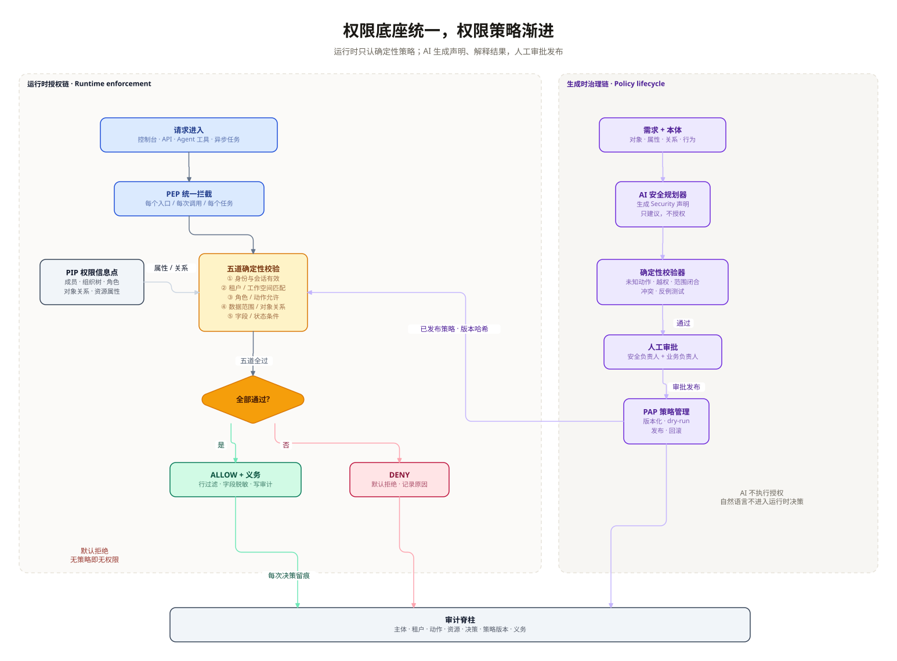
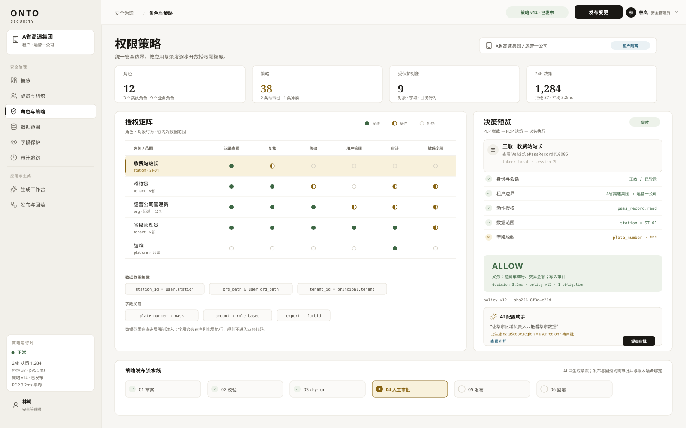

# 权限管理设计与实现方案：统一底座，渐进策略

> 状态：设计稿 · 2026-11-03  
> 实现完成度与验收证据：[implementation-review.md](implementation-review.md)  
> 范围：认证、租户隔离、RBAC、ABAC/ReBAC、数据范围与字段保护、策略生成与发布、Agent 权限继承  
> 结论：**权限内核一次做对，策略能力按应用复杂度逐步开放。** 当前 `workspace_id` 事实上承担租户边界，不能把它继续当成“角色表旁边的一个字段”；应把它升级为可验证的 `Tenant` 上下文，并把现有 `AccessPolicy` 保留为默认策略实现，而不是推倒重来。

---

## 0. 结论先行

1. **四层边界必须分开**：L1 认证回答“你是谁”，L2 租户隔离回答“你属于哪个安全边界”，L3 RBAC 回答“你在这个边界里能做什么动作”，L4 ABAC/ReBAC 回答“你能碰到哪一行、哪一个对象、哪一个字段”。租户隔离不是角色，不能靠 `owner` 绕过；平台审计员是显式的跨租户**只读**授权，必须带范围、时限和审计，不能用于写操作。
2. **成熟度不是安全强度**：Demo / Team / Enterprise 的差异是产品配置复杂度，不是安全等级。三个档位都必须 deny-by-default、都必须有租户断言、都必须留审计；只是 Enterprise 开放更多策略表达和治理流程。
3. **统一授权内核，渐进暴露策略**：PAP 管策略、PDP 做决策、PEP 做拦截、PIP 提供事实。运行时只认已发布策略；AI 只生成候选声明，确定性校验器和人工审批负责发布。
4. **权限是 Blueprint 的一部分**：应用蓝图不只声明“看什么、做什么”，还要声明“谁能看、能看哪一行、哪些字段要遮”。AI 提议 `security` 块，平台校验，人审批，运行时按版本执行。
5. **现有资产可复用**：`AccessPolicy.ACTION_POLICY`、`Membership`、`require_action()`、workspace 级 Repository、append-only audit 都是迁移起点。V0.1 不改变现有三角色行为，只把调用链改造成 `Principal → PEP → PDP → Decision → ScopedRepository`。
6. **AI 永远不是最终授权者**：模型输出只能是策略草案或解释；`ALLOW/DENY` 由确定性 PDP 产生，且决策必须带策略版本、原因码和义务。

---

## 1. 需求拆解：权限到底在管什么

| 层 | 要回答的问题 | 失败后果 | 本方案的落点 |
|---|---|---|---|
| L1 认证 | 请求者是谁，凭证是否可信 | 冒充、令牌重放 | `Principal` + token/SSO 适配器 |
| L2 租户隔离 | 这次请求属于哪个租户/工作空间 | 跨租户数据泄露 | `TenantContext` + 强制租户断言 + 存储键 |
| L3 RBAC | 这个角色能否执行这个动作 | 越权操作 | `RoleBinding` + 动作策略 |
| L4 数据权限 | 能看哪些行、哪些对象、哪些字段 | 行级/字段级泄露 | scope 过滤器 + 关系授权 + 字段义务 |
| 策略治理 | 谁改策略、怎么审批、怎么回滚 | 策略漂移、无法追责 | PAP + 版本 + dry-run + 审批 + 审计 |
| Agent 权限 | Agent 是否借工具放大调用者权限 | 间接越权 | 调用者 `AuthorizationContext` 透传，禁止提权 |

关键判断：

- **租户隔离必须是一个“上下文”，不是一次 `if`。** 只在 API 入口检查 `tenant_id` 不够；数据库查询、缓存键、对象存储前缀、异步任务、Agent 工具调用都必须携带同一个租户上下文。
- **权限判断必须和查询绑定。** 当前代码靠约定“授权时传 `workspace_id`，查询时也传同一个”，没有类型约束。应返回一个 `AuthorizedScope` 句柄，Repository 只接受这个句柄，避免“在 A 空间检查、去 B 空间查询”的错配。
- **字段权限不是展示层问题。** 字段脱敏必须在序列化/导出/送入模型之前执行；只在 UI 隐藏列，API 仍然会泄露。

---

## 2. 现状审计（基于当前代码）

### 2.1 已经具备的基线

| 能力 | 现状 | 代码锚点 |
|---|---|---|
| 身份解析 | `ONTO_API_TOKEN` 存在时只接受 bearer token；本地回环模式接受 body/query 的 `user` | `interfaces/api.py:290-320` |
| 工作空间成员 | `Membership(workspace_id, user, role)`，角色只有 `viewer/editor/owner`，按 rank 比较 | `domain/governance/model.py:53-126` |
| 动作矩阵 | `AccessPolicy.ACTION_POLICY` 把 action 映射到 `(required_role, target)` | `domain/governance/model.py:79-93` |
| 统一入口 | `ApplicationContext.require()` / `require_action()` | `application/common.py:129-144` |
| 成员管理 | 创建者成为 owner；最后 owner 不能被降级/删除 | `application/workspace_usecases.py:36-68,201-250` |
| 可见性 | `ListWorkspaces` 只返回 actor 有 membership 的空间 | `application/workspace_usecases.py:89-102` |
| 审计 | append-only，记录 actor/workspace/action/target/detail | `domain/governance/model.py:134-151`，`sqlite_repo.py:26-34` |
| 存储隔离 | `documents` 主键 `(kind, workspace_id, entity_id)` | `sqlite_repo.py:17-25` |
| Agent 动作 | `RunAgent` 要求 viewer；写动作走 `InvokeCapability`，要求 editor | `application/intelligence_usecases.py:97-141`，`agent_runner.py:420-450` |
| Smart UI | 自己维护 `ACTION_ROLES`、`_actor_role`、`_require_roles_at_most` | `application/smartui/bridge.py:394-395,2006-2027,2602-2617` |

### 2.2 关键缺口

1. **没有显式 `Tenant` 模型。**
   `workspace_id` 是事实上的隔离键，但 `documents`/`audit_log` 没有 `tenant_id`；没有“工作空间属于哪个租户”的强约束，也没有跨租户查询的显式拒绝点。多工作空间场景下，`platform_admins` 的只读跨空间访问是特例，不是通用租户模型。

2. **只有工作空间级 RBAC，没有数据范围。**
   `AccessPolicy.check_action()` 只比较角色 rank；`ACTION_POLICY` 里的 `target` 字段目前只是描述，没有参与决策，更没有行过滤、对象关系、字段遮罩。

3. **动作策略硬编码。**
   新增动作要改 Python 字典；策略不能按租户/应用版本化，不能 draft、dry-run、发布、回滚。Smart UI 还另有一套角色判断，容易与 `AccessPolicy` 漂移。

4. **PEP 不统一。**
   HTTP API、Smart UI、Agent、后台任务各自调用 `require`/`require_action` 或自己的角色检查。没有“每个入口都必须经过同一个 PEP”的结构性保证；异步执行只通过 `gateway.execution_actor()` 传了 actor 字符串，没有传租户/数据范围/义务。

5. **决策信息不足。**
   审计只有 actor/action/target；没有 `decision_id`、`reason_code`、`policy_version`、`obligations`、`resource`、`deny` 原因。出现“为什么这个人能看到这条记录”时，无法从审计还原。

6. **Agent 只继承了“角色”，没有继承“数据边界”。**
   写动作的 actor 通过 `execution_actor()` 传递，方向是对的；但 Agent 的工具读取仍走 workspace 级 Repository，调用者的 row scope / field mask 没有进入工具上下文。对 viewer 来说，Agent 可能读到本应被行过滤或字段遮罩的数据。

7. **缓存/对象存储没有租户键约束。**
   运行时网关缓存键是 `(workspace_id, ring)`，没有显式 `tenant_id`；未来对象存储、导出文件、缓存条目必须统一加租户前缀。否则一旦工作空间 ID 被复用或拼错，隔离会穿透。

8. **最后 owner 保护是“数量保护”，不是“治理保护”。**
   当前能防止最后一个 owner 被删，但没有 owner 转让审批、双人审批、职责分离（SoD）和 break-glass 记录。

### 2.3 不能直接照搬的假设

- 不能假设“有了 `workspace_id` 就天然多租户”。租户是安全边界，工作空间是业务协作边界；两者可以暂时重合，但必须有朝 `Tenant -> Workspace` 演进的路径。
- 不能假设“角色越高，数据范围越大”。`owner` 可以管理成员，但不一定应该看到所有业务行；数据范围必须独立授权。
- 不能假设“AI 生成的策略可以直接发布”。模型擅长提议，不擅长证明“没有越权”；必须由确定性校验器 + 人工审批兜底。

---

## 3. 目标架构

### 3.1 分层与组件

```text
┌────────────────────────────────────────────────────────────────────┐
│ 入口层：Console / API / Agent Tool / Async Job                       │
│  - 解析 Principal（token / session / service identity）              │
│  - 绑定 TenantContext（tenant_id + workspace_id）                    │
└───────────────────────────────┬────────────────────────────────────┘
                                │ AuthorizationContext
┌───────────────────────────────▼────────────────────────────────────┐
│ PEP 统一拦截层                                                       │
│  - authorize(action, resource) -> Decision                           │
│  - 拒绝时返回 reason_code；允许时强制 obligations                     │
│  - 生成 AuthorizedScope 句柄，Repository 只接受该句柄                 │
└───────────────┬──────────────────────────────────┬─────────────────┘
                │                                  │
┌───────────────▼──────────────┐   ┌───────────────▼─────────────────┐
│ PIP 权限信息点                │   │ PDP 策略决策点                   │
│  - 成员 / 组织树 / 角色绑定    │   │  - 固定顺序：认证 → 租户 → 动作   │
│  - 对象关系 / 资源属性         │   │    → 资源关系 → 条件 → 字段       │
│  - 已发布策略版本              │   │  - 默认拒绝；deny 优先            │
└──────────────────────────────┘   └───────────────┬─────────────────┘
                                                   │ Decision
┌──────────────────────────────────────────────────▼─────────────────┐
│ 执行与义务层                                                        │
│  - ScopedRepository：SQL WHERE 强制注入 tenant/scope                 │
│  - Serializer / Export / LLM context：field_mask 先于输出            │
│  - ObjectStore / Cache：key 必须包含 tenant_id                       │
│  - Audit：decision_id + policy_version + obligations                │
└────────────────────────────────────────────────────────────────────┘

┌────────────────────────────────────────────────────────────────────┐
│ PAP 策略管理与生成时治理                                             │
│  需求 + 本体 → AI 提议 security 声明 → 确定性校验 → dry-run         │
│  → 人工审批 → 发布版本 → 运行时按版本执行 → 回滚                      │
└────────────────────────────────────────────────────────────────────┘
```



图中左侧是运行时授权链：请求进入后先经过 PEP，再由 PIP 提供成员/组织/关系事实，PDP 做五道确定性校验，最后 ALLOW 带义务或 DENY。右侧是生成时治理链：AI 只生成 Security 声明，校验器、人工审批、PAP 依次把关，运行时只加载已发布版本。

### 3.2 四层职责

#### L1 认证：Principal

```text
Principal {
  id, type: user | service | agent,
  tenant_id,
  display_name,
  attributes: {department, station_id, org_path, ...},
  authn: {method, issuer, subject, expires_at}
}
```

- API token 模式：token 映射到固定 actor，不能由 body 覆盖（当前已做到）。
- 本地回环模式：只用于开发，必须显式标记 `authn.method = local`，生产环境禁止。
- Agent：Principal 的 `type=agent`，但必须携带 `on_behalf_of` 调用者；不允许 Agent 自己拥有比调用者更高的角色。

#### L2 租户隔离：TenantContext

```text
TenantContext {
  tenant_id,
  workspace_id,
  boundary: "tenant" | "workspace",
  source: "token" | "session" | "job" | "agent"
}
```

- 所有入口先解析租户，再做任何业务读取。
- `tenant_id` 与 `workspace_id` 必须匹配；工作空间属于租户的映射关系是强约束。
- 仓储、缓存、对象存储、异步任务都从 `TenantContext` 取键，不接受业务代码自行拼接。
- 跨租户请求统一返回 403，不暴露资源是否存在；同租户无权限也返回 403，但 reason_code 可区分（内部审计可见，外部响应不泄露细节）。
- 现有 `platform_admins` 的跨工作空间只读访问是审计员特例，不是通用租户模型：迁移后建模为 `RoleBinding(scope=platform, role=auditor)`，只允许读，且每次决策单独审计；任何写操作仍必须匹配目标租户。

#### L3 RBAC：RoleBinding

```text
RoleBinding {
  subject: user | group,
  role: viewer | editor | owner | custom_role,
  scope: tenant | workspace | org_unit,
  condition?: AttributeCondition,
  source: "legacy_membership" | "manual" | "idp_group"
}
```

- `Membership` 保留为兼容投影：`RoleBinding(subject=user, role=workspace_role, scope=workspace)`。
- 角色继承必须有向无环；内置角色 `viewer < editor < owner`，自定义角色只能继承内置角色或已有自定义角色，不能形成环。
- 最后 owner 保护继续保留，并增加“owner 转让需双人审批”的企业档能力。

#### L4 数据权限：Scope + Relation + Field

- **行范围**：把策略里的 `scope` 编译成 SQL `WHERE`/内存过滤，例如 `tenant_id = ? AND station_id = ?`。
- **对象关系**：`owner`、`member_of`、`belongs_to`、`can_read` 等 relation tuple；先做有限深度的 ReBAC，不追求完整 Zanzibar。
- **字段义务**：`field_mask` 在序列化前执行；导出、Webhook、Agent prompt 都必须走同一套 masker。
- **状态条件**：如“只能复核自己站点的未复核记录”，用资源属性 + principal 属性判断，不写进业务代码。

### 3.3 决策结果

```text
Decision {
  decision_id,
  effect: "allow" | "deny",
  reason_code: "allowed" | "tenant_mismatch" | "action_denied"
             | "scope_denied" | "relation_denied" | "condition_denied"
             | "field_denied" | "no_policy" | "obligation_unenforceable",
  policy_version,
  resource: {type, id},
  obligations: [
    {type: "row_filter", filter: FilterAst},
    {type: "field_mask", fields: {plate_number: "plate"}},
    {type: "audit", level: "decision"},
    {type: "watermark", value: "..."},
    {type: "approval_required", workflow: "unmask"}
  ],
  ttl_seconds
}
```

规则：

- **默认拒绝**：没有匹配策略、找不到资源、PIP 查询失败，都返回 deny。
- **deny 优先**：同一请求同时命中 allow 和 deny 时，deny 胜出。
- **义务不可忽略**：PEP 如果无法执行某个 obligation（例如 Repository 不支持行过滤），必须降级为 deny，而不是“先放行再提醒”。
- **决策可复现**：同一 `policy_version + principal + resource + action + attributes` 必须得到同一结果；缓存键包含策略版本。

---

## 4. 运行时授权链

### 4.1 一次请求的完整路径

```text
请求
  → 认证：token/session → Principal
  → 租户断言：tenant_id 必须与目标 workspace 匹配
  → PEP：authorize(action, resource)
      → PIP：加载 membership / group / relation / attributes / policy_version
      → PDP：认证有效 → 租户匹配 → 动作允许 → 资源关系/范围 → 条件 → 字段
      → Decision
  → deny：403 + reason_code + audit(decision)
  → allow：把 obligations 编译成 ScopedQuery / Masker / Audit
  → 仓储执行：tenant_id + workspace_id + scope 强制注入
  → 序列化/导出/模型上下文：字段遮罩
  → 返回 + 审计
```

### 4.2 五道确定性校验

1. **身份与会话有效**：principal 存在、未禁用、token 未过期、issuer 可信。
2. **租户/工作空间匹配**：`principal.tenant_id == resource.tenant_id == context.tenant_id`；工作空间属于该租户。
3. **角色/动作允许**：存在覆盖该 action 的 RoleBinding，且动作策略允许该角色。
4. **数据范围/对象关系**：scope 过滤器匹配；对象关系可达；资源状态满足条件。
5. **字段/输出条件**：字段策略给出 mask/strip；导出/Agent 上下文同样执行。

> 顺序不是“先查角色再查租户”可以随意调整的。租户检查必须在任何业务读取之前；否则一个错误的 `workspace_id` 就可能先读到数据，再被角色检查“事后发现”。

### 4.3 PEP 的三种形态

- **API PEP**：在 HTTP handler 入口调用，解析 Principal 和 TenantContext；所有写操作先授权再执行。
- **Use-case PEP**：`ApplicationContext.require_action()` 内部改为调用 PDP，保留现有签名，避免大范围改调用点。
- **Data PEP**：`ScopedRepository` 只接受 `AuthorizedScope`，把 tenant/workspace/row filter 强制注入查询；这是第二道防线，防止 use-case 漏调。
- **Agent PEP**：Agent 每次工具调用都携带调用者的 `AuthorizationContext`，工具内部再用同一个 PDP；不允许工具自己用“service account”提权。
- **Async PEP**：任务创建时序列化 `AuthorizationContext`（或至少 tenant + principal + scope + policy_version），worker 执行前重新校验；上下文缺失直接拒绝，不默认放行。

### 4.4 义务执行

| obligation | 执行位置 | 失败策略 |
|---|---|---|
| `row_filter` | `ScopedRepository.list/get/find` | 无法编译/不支持 → deny |
| `field_mask` | serializer / export / LLM context | 未注册 masker → deny |
| `audit` | audit writer | 写失败 → 拒绝高风险操作 |
| `watermark` | 导出/打印 | 不支持 → deny 导出 |
| `approval_required` | 动作入口 | 无审批 → 拒绝执行 |

---

## 5. 数据模型

### 5.1 核心实体

```text
Tenant(id, name, status, idp_config?, created_at)
Workspace(id, tenant_id, name, description, ...)
Principal(id, tenant_id, type, display_name, status, attributes_json)
Group(id, tenant_id, parent_id, path, name)
GroupMember(group_id, principal_id)
Role(id, tenant_id?, name, builtin, inherits_json)
RoleBinding(id, tenant_id, subject_type, subject_id, role_id,
            scope_type, scope_id, condition_json, source)
Policy(id, tenant_id, version, status, schema_version,
       document_json, hash, created_by, approved_by,
       published_at, created_at)
Resource(type, id, tenant_id, workspace_id, owner_id,
         attributes_json, status)
RelationTuple(resource_type, resource_id, relation, subject_type, subject_id)
AuthorizationDecision(id, tenant_id, workspace_id, principal_id,
                      action, resource_type, resource_id,
                      effect, reason_code, policy_version,
                      obligations_json, created_at)
```

### 5.2 与现有模型的关系

| 现有 | 迁移后 | 兼容策略 |
|---|---|---|
| `Membership(workspace_id, user, role)` | `RoleBinding(scope=workspace)` | 读路径先读 `membership`，写路径双写；V0.2 后以 binding 为准 |
| `AccessPolicy.ACTION_POLICY` | 默认 Policy 文档 | 启动时把内置矩阵编译为默认策略包，行为保持一致 |
| `AuditEntry` | 保留，新增 decision 字段 | 新表/新列追加，不回填历史语义 |
| `documents.workspace_id` | 增加 `tenant_id` 列 | 先回填、加索引，不重建主键 |
| `execution_actor()` | `AuthorizationContext` | actor 字符串保留用于日志，完整上下文单独传递 |

### 5.3 存储迁移

V0.1：

1. `workspace` 增加 `tenant_id`，回填 `tenant_id = workspace_id`（工作空间即租户）。
2. `documents` 增加 `tenant_id`，按 `workspace_id` 回填；保留原主键，新增 `(tenant_id, kind, workspace_id)` 索引。
3. 新增 `policies`、`policy_approvals`、`authorization_decisions` 三张表；继续用 SQLite，不引入外部服务。
4. 旧 `membership` 不动；新增 `role_bindings`，启动时一次性 backfill。

V0.2 以后：

- 引入真正的 `tenants` 表，`workspace.tenant_id` 指向它；`tenant_id` 不再等于 `workspace_id`。
- `membership` 变只读兼容视图；所有新授权写 `role_bindings`。
- 历史审计保留原字段，新决策记录带 `policy_version`；不伪造历史版本。

---

## 6. Blueprint 中的 Security 声明

### 6.1 放在哪里

建议在 Blueprint v1.1 中增加可选的 `security` 块，与 `context`、`views`、`actions` 同级：
```yaml
schemaVersion: "1.1"
security:
  schemaVersion: "1.0"
  tenant:
    boundary: workspace       # V0.1：工作空间即租户；V0.2 可改 tenant
    claim: tenant_id
  roles:
    - id: viewer
      builtin: true
    - id: station_manager
      label: 收费站站长
      inherits: [viewer]
  scopes:
    station_self:
      match:
        all:
          - field: tenant_id
            op: eq
            valueFrom: principal.tenant_id
          - field: station_id
            op: eq
            valueFrom: principal.attributes.station_id
  actionPolicies:
    - action: pass_record.read
      resource: VehiclePassRecord
      allowRoles: [station_manager, auditor]
      scope: station_self
      fields:
        plate_number: {effect: mask, mask: plate}
        amount: {effect: mask, mask: currency}
  approval:
    requiredFor: [policy.publish, role.grant_owner, field.unmask]
    approvers: [security_owner, business_owner]
    separationOfDuties: true
```

落地时要同步修改引擎侧 `vibe-可视化engine/docs/blueprint-schema.yaml`：把 `schemaVersion` 的 `const` 从 `1.0` 升到 `1.1`（或增加 oneOf 兼容），在 `properties` 增加 `$defs/security`，并在平台 adjudication 的白名单里放行 `security` 字段。否则现有 v1.0 Schema 的 `additionalProperties: false` 会直接拒绝新字段；不能只改提示词。

### 6.2 约束

- `security` 只能引用已经存在的对象、属性、关系、动作；未知名称直接校验失败。
- `scope` 必须是结构化 AST，不允许原始 SQL、JavaScript、Python 表达式。
- `tenant_id` 条件由平台强制注入，作者不能关闭；如果作者写了与租户冲突的条件，校验失败。
- 角色继承必须无环；`allowRoles` 不能包含未定义角色。
- 字段策略只能引用该对象已声明的字段；`mask` 必须是平台注册的 masker。
- `approval.requiredFor` 必须覆盖高风险动作；`separationOfDuties=true` 时审批人不能是提交人。

### 6.3 生成与发布

```text
需求 + 已发布本体 + 数据概览
  → AI 生成 security 草案（只建议）
  → Schema 校验 + 引用完整性校验
  → 安全不变量校验（租户闭合、无未知动作、无越权提升、角色无环）
  → dry-run：用样本/空数据跑决策，输出 diff 和反例
  → 人工审批（安全负责人 + 业务负责人，按风险分级）
  → 发布为不可变 Policy vN（带 hash）
  → 运行时加载 vN，审计记录版本
```

AI 的输出边界：

- 可以生成：角色、scope AST、动作允许列表、字段 mask 建议、审批要求。
- 不可以生成：绕过校验的“例外”、直接写 SQL、动态代码、未注册的 masker、关闭租户断言的配置。
- 不可以执行：最终 ALLOW/DENY、审批、发布。

### 6.4 校验器最小规则集

1. **引用完整性**：对象/属性/关系/动作存在且已发布。
2. **租户闭合**：每个 scope 必须包含 `tenant_id` 谓词；每个 action policy 必须绑定租户或工作空间范围。
3. **无提权**：AI 不能把 `owner` 能力授予一个原本只有 `viewer` 的角色而不显式声明；高风险变更进入审批。
4. **角色无环 / 继承有界**。
5. **字段策略闭合**：mask 字段必须存在，masker 已注册；导出路径同样生效。
6. **冲突检测**：同一主体/动作/资源同时命中 allow 和 deny 时，明确按 deny 处理并提示冲突。
7. **不可达策略**：永远不可能命中的规则给出警告（不是静默通过）。
8. **反例测试**：对高风险策略生成“应该被拒绝”的样例，dry-run 必须拒绝。

---

## 7. AI 与人工的边界

| 环节 | AI | 确定性系统 | 人 |
|---|---|---|---|
| 需求理解 | 提议 role/scope/action | 校验引用与不变量 | 确认业务语义 |
| 策略生成 | 产出 `security` 草案 | Schema + dry-run + 反例 | 审批 |
| 运行时决策 | 不参与 | PDP 产出 ALLOW/DENY | 不参与 |
| 结果解释 | 可解释“为什么被拒” | reason_code + 审计 | 复核 |
| 发布/回滚 | 不执行 | 版本化 + hash + 审计 | 审批/触发 |

硬性要求：

- 模型输出必须经过 JSON Schema 和业务校验，失败即拒绝，不做“尽量修复”。
- 模型不能读取未脱敏的字段来生成策略建议；生成上下文本身也要经过调用者的字段义务。
- 模型不能决定 `ALLOW`；即使模型说“允许”，PDP 仍按策略执行。
- 所有 AI 生成的策略草案标记 `generatedBy=ai_planner`，发布时保留来源和 diff。

---

## 8. 代码落点与接口设计

### 8.1 新增模块

```text
src/onto_platform/domain/security/
  model.py            Principal / Tenant / Group / RoleBinding /
                      Policy / Decision / Obligation / ResourceRef
  filters.py          FilterAst → SQL/内存过滤；禁止原始表达式
src/onto_platform/application/security/
  context.py          TenantContext / AuthorizationContext / AuthorizedScope
  pip.py              成员、组织树、关系、属性、策略版本加载
  pdp.py              固定顺序决策；默认拒绝；deny 优先
  pep.py              authorize() + obligation 执行入口
  policy_store.py     draft/validate/dry-run/approve/publish/rollback
  masker.py           field mask 注册表与序列化前执行
  blueprint_security.py  从 Blueprint 抽取/校验 security 块
  errors.py           reason_code 映射
```

### 8.2 改造现有模块

| 模块 | 改造 |
|---|---|
| `application/common.py` | `require` / `require_action` 内部改为 `pep.authorize()`；新增 `authorization_context`；`ApplicationContext` 持有 `PolicyStore` |
| `interfaces/api.py` | `_actor()` 升级为 `_principal()`；解析租户头/令牌声明；403 返回 reason_code（不泄露资源存在性） |
| `application/workspace_usecases.py` | 创建空间时写 `tenant_id` 和默认 owner binding；成员操作改写 role_binding，保留 membership 投影 |
| `application/agent_runner.py` | `make_audited_invoker` 接收 `AuthorizationContext`，不再只传 actor；工具调用前重新授权 |
| `application/intelligence_usecases.py` | `RunAgent` 构建调用者上下文，传入 AgentRunner；Agent 结果写入前再次检查字段义务 |
| `application/smartui/bridge.py` | 删除独立 `_actor_role`/`ACTION_ROLES` 决策，改为调用统一 PDP；视图/动作义务复用同一个 Decision |
| `infrastructure/persistence/sqlite_repo.py` | 新增 tenant/policy/decision 表；`list/get/find` 接受 `AuthorizedScope` 并注入过滤 |
| `infrastructure/runtime/kernel_gateway.py` | `execution_actor()` 扩展为 `execution_context()`，保留 actor 兼容 |
| `application/execution_runner.py` / `scheduler.py` | 任务入队时序列化安全上下文；worker 启动时重新校验，缺失即拒绝 |
| `frontend` | 权限控制台：角色矩阵、策略编辑/预览、决策预览、策略流水线 |

### 8.3 关键接口

```text
POST /api/security/authorize/preview
  body: {action, resource: {type, id}, principal?}
  → Decision（只预览，不产生副作用）

GET  /api/security/policies
POST /api/security/policies                  # 创建 draft
POST /api/security/policies/{id}/validate
POST /api/security/policies/{id}/dry-run
GET  /api/security/policies/{id}/diff
POST /api/security/policies/{id}/approve
POST /api/security/policies/{id}/publish
POST /api/security/policies/{id}/rollback

GET/POST /api/security/roles
GET/POST /api/security/bindings
GET/POST /api/security/scopes
GET/POST /api/security/relations
GET  /api/security/decisions/{id}
```

接口约束：

- 所有接口先经过 API PEP；策略管理接口要求 `security.manage` 动作和 owner/安全管理员角色。
- `authorize/preview` 必须复用与真实请求相同的 PDP，不能另写一套“预览逻辑”。
- 发布/回滚需要 `If-Match` 或 `expected_version`，防止并发覆盖。
- 列表接口不能返回调用者无权看到的行；分页总数也要按 scope 计算。

---

## 9. 分阶段实施

### V0.1 可替换的授权内核（1–2 周）

**交付**

- 新增 `Principal`、`TenantContext`、`AuthorizationContext`、`Decision`、`Obligation`。
- `ApplicationContext.require()` / `require_action()` 内部改走 PEP；保持现有签名和三角色行为。
- `workspace.tenant_id` 回填；`documents.tenant_id` 回填；新增 `authorization_decisions`。
- API 入口解析 Principal；审计写入 `decision_id`、`reason_code`、`policy_version`（默认 `legacy-v0`）。
- 兼容测试：现有工作空间/成员/动作行为不变。

**退出标准**

- 每个 API 请求都能拿到 `tenant_id + principal + decision_id`。
- 跨租户/跨工作空间访问被拒绝，审计可查。
- 现有测试全绿；没有新增未授权写入。

### V0.2 租户/组织/RBAC/数据范围（2–3 周）

**交付**

- `Tenant`、`Group`、`RoleBinding`、`PolicyStore`。
- 默认策略包由 `ACTION_POLICY` 编译生成；新增动作只改策略数据，不改决策代码。
- `ScopedRepository`：SQL `WHERE` 注入 tenant/workspace/scope。
- 组织树 + `org_path` 范围；至少两个业务对象接入行过滤。
- 权限控制台：角色矩阵、scope 编辑、决策预览。

**退出标准**

- `station_manager` 只能读取本站数据；跨站/跨组织返回空集或 403（按接口语义）。
- 策略 dry-run 能给出“某用户某资源”的允许/拒绝原因。
- Smart UI 不再保留独立的动作角色判断。

### V0.3 对象级关系与 Agent 继承（2–3 周）

**交付**

- `RelationTuple`、对象级 `can_read/can_edit/can_delete`；有限深度关系解析。
- Agent 工具调用携带调用者 `AuthorizationContext`；工具读取走 `ScopedRepository`。
- 异步任务/调度器序列化安全上下文；worker 重新校验。
- 对象存储/缓存键加 `tenant_id` 前缀。

**退出标准**

- 构造“Agent 读取调用者无权读取的对象”测试，必须被拒绝。
- 构造“任务无上下文执行”测试，必须 deny。
- 关系授权不能通过循环/深链绕过；有深度上限和超时。

### V0.4 ABAC/字段策略/策略治理（2–3 周）

**交付**

- 条件属性（部门、站点、资源状态、时间）与字段 mask/strip。
- 导出、Webhook、LLM 上下文统一走 masker。
- 策略 draft → validate → dry-run → approve → publish → rollback 全流程。
- AI 生成 `security` 草案；确定性校验器 + 反例测试；双人审批。
- 控制台策略流水线、diff、决策预览。

**退出标准**

- 字段不可见时 API/导出/模型上下文都拿不到原值。
- AI 生成的非法策略 100% 被拒；高风险变更必须审批。
- 发布/回滚有不可变版本和 hash；运行时决策审计带版本。

### V0.5 企业级身份与治理（2–4 周）

**交付**

- OIDC/LDAP/SCIM、SSO 会话、组同步。
- 审计导出、保留策略、告警；审批工作流、委派、break-glass。
- 多租户管理台、配额、跨租户审计视图（只读且受控）。
- 策略影响分析（“改这条会影响谁”）。

**退出标准**

- 外部 IdP 登录可用；组变更同步到 RoleBinding。
- break-glass 有明确时限、双人复核、全量审计。
- 审计可导出且不可篡改；租户管理员不能看到其他租户。

---

## 10. 测试与验收

### 10.1 单元/属性测试

- 决策顺序：认证失败 → deny；租户不匹配 → deny；动作不允许 → deny；scope 不匹配 → deny；字段义务 → allow + mask。
- deny 优先：同时 allow/deny 时 deny。
- 默认拒绝：无策略、未知动作、未知资源。
- 角色继承：有向无环；越级继承被拒。
- scope 编译：tenant 条件不可省略；空 scope 不能变成“全量”。
- 字段 mask：嵌套对象/数组/导出/模型上下文一致。
- 策略校验：未知引用、未注册 masker、关闭租户断言、提升 owner 权限均失败。

### 10.2 集成/安全测试

- 跨租户 IDOR：用 A 租户 token 访问 B 租户资源，403 且不泄露存在性。
- 工作空间错配：授权用 A、查询用 B，被 `AuthorizedScope` 阻断。
- Agent 提权：viewer 调用 Agent 读取受限行，拒绝；Agent 不能借用 service account。
- 异步任务：无上下文/上下文过期，拒绝。
- 缓存键：不同租户/策略版本不能命中同一缓存。
- Smart UI：动作按钮、视图字段与 PDP 决策一致；不能靠前端隐藏代替后端授权。
- 审计：每条 allow/deny 都能追溯到 decision_id、policy_version、资源。

### 10.3 回归与性能

- 现有测试全部通过；旧三角色行为通过兼容用例。
- PDP 决策 P95 目标：本地 < 5ms；复杂关系/ABAC 允许一次批量预取，禁止 N+1。
- 决策缓存：按 `(tenant, workspace, principal, action, resource_type, resource_id, policy_version)` 缓存，TTL 30–60s；策略发布立即失效。
- 大列表：scope 过滤下推数据库，不在 Python 全量过滤。

### 10.4 验收清单

- [ ] 没有租户上下文的请求不能进入业务层。
- [ ] 没有 `AuthorizedScope` 的 Repository 查询不能执行。
- [ ] 每个 allow/deny 都有 decision 审计。
- [ ] 字段 mask 在 API/导出/LLM 三处一致。
- [ ] Agent 与异步任务不能放大调用者权限。
- [ ] AI 不能发布策略，也不能直接产生 ALLOW。
- [ ] 策略发布/回滚可复现，版本 hash 可查。

---

## 11. 风险与取舍

| 风险 | 影响 | 缓解 |
|---|---|---|
| 把 workspace 当租户，长期难拆 | 多租户产品化受阻 | V0.1 回填 `tenant_id`，V0.2 引入独立 Tenant；代码只依赖 `TenantContext` |
| 现有 `require` 默认 editor，语义被沿用 | 误把“能编辑”当“能看全部数据” | 动作权限与数据范围分开建模；默认策略保持行为但显式声明 scope |
| Smart UI 独立角色判断 | 两套规则漂移 | 删除本地决策，统一调用 PDP；UI 只消费 Decision |
| 仓储查询绕过 PEP | 行级泄露 | `AuthorizedScope` 类型约束 + 数据层第二道防线 |
| 决策缓存串租户 | 严重泄露 | 缓存键包含 tenant/principal/policy_version；发布失效 |
| 字段 mask 只在 UI | API 泄露 | masker 在序列化层统一执行；导出/模型上下文复用 |
| AI 幻觉/过度授权 | 策略漏洞 | Schema + 不变量 + dry-run + 反例 + 双人审批；AI 不执行 |
| 策略爆炸/不可读 | 运维困难 | 默认策略包、角色模板、影响分析、不可达策略警告 |
| 性能下降 | 体验退化 | PIP 批量预取、决策缓存、scope 下推数据库 |
| 审计含敏感数据 | 二次泄露 | detail 脱敏；审计访问本身受权限控制；保留策略 |

---

## 12. 待决策问题

1. **Tenant 与 Workspace 的关系**：V0.1 采用 `workspace_as_tenant`，V0.2 是否引入“一个租户多个工作空间”？建议引入，否则企业客户无法按项目隔离。
2. **策略表达语言**：使用平台自定义的结构化 AST，还是 CEL/Rego？建议先自定义 AST（可编译到 SQL、可审计、无副作用），复杂条件再评估 CEL。
3. **PEP 位置**：应用层 PEP + 数据层 PEP 双保险，是否接受少量重复检查？建议接受；数据层是防漏网的关键。
4. **角色模型**：继续用 `viewer/editor/owner` 作为内置角色，自定义角色只做增量继承；是否允许租户自定义动作？建议 V0.2 只允许组合已有动作，V0.4 再开放动作注册。
5. **策略强制开关**：迁移期是否保留 `security.enforce=false` 兼容开关？建议仅用于本地迁移，生产默认强制；开关本身要审计。
6. **Agent 工具授权粒度**：按工具授权还是按底层动作授权？建议按底层动作，工具只是入口；否则新增工具会绕过策略。

---

## 13. 效果图说明



效果图展示的是 V0.2–V0.4 的目标控制台，不是当前已实现界面：

- 左侧：租户/工作空间上下文、成员与组织、角色与策略、数据范围、字段保护、审计。
- 中部：角色 × 对象行为授权矩阵，行内标注数据范围；下方是 scope 编译和字段义务。
- 右侧：单次请求的决策预览，展示五道校验、ALLOW、义务、策略版本；底部是 AI 配置助手，只生成待审批的声明。
- 底部：策略发布流水线（草案 → 校验 → dry-run → 人工审批 → 发布 → 回滚），强调“AI 只生成草案”。

---

## 附录 A：当前代码锚点

| 主题 | 文件 | 关键行 |
|---|---|---|
| 角色与动作矩阵 | `src/onto_platform/domain/governance/model.py` | 53–126 |
| 审计实体 | 同上 | 134–151 |
| `require` / `require_action` | `src/onto_platform/application/common.py` | 129–144 |
| actor 解析 | `src/onto_platform/interfaces/api.py` | 290–320 |
| 创建空间即 owner | `src/onto_platform/application/workspace_usecases.py` | 36–68 |
| 最后 owner 保护 | 同上 | 201–250 |
| Agent 动作 | `src/onto_platform/application/intelligence_usecases.py` | 97–141 |
| Agent invoker | `src/onto_platform/application/agent_runner.py` | 420–450 |
| Smart UI 角色检查 | `src/onto_platform/application/smartui/bridge.py` | 394–395, 2006–2027, 2602–2617 |
| SQLite 文档/审计表 | `src/onto_platform/infrastructure/persistence/sqlite_repo.py` | 17–35 |
| 执行 actor 线程本地 | `src/onto_platform/infrastructure/runtime/kernel_gateway.py` | 384–390 |

## 附录 B：最小决策伪代码

```python
def authorize(ctx: AuthorizationContext, action: str, resource: ResourceRef) -> Decision:
    principal = ctx.principal
    if not principal.active:
        return deny("unauthenticated")

    if principal.tenant_id != ctx.tenant_id or resource.tenant_id != ctx.tenant_id:
        return deny("tenant_mismatch")

    policy = policy_store.published(ctx.tenant_id)
    if policy is None:
        return deny("no_policy")

    # 1) RBAC：动作 + 角色绑定
    binding = pip.match_binding(principal, action, resource, policy)
    if binding is None:
        return deny("action_denied")

    # 2) Scope：行级过滤
    scope = pip.scope_of(binding, principal, resource)
    if not scope.matches(resource):
        return deny("scope_denied")

    # 3) 关系 / 条件
    if not pip.relation_allows(principal, action, resource):
        return deny("relation_denied")
    if not pip.conditions_hold(binding, principal, resource, ctx.env):
        return deny("condition_denied")

    # 4) 字段义务
    obligations = pip.field_obligations(principal, action, resource, policy)
    if not pep.can_enforce(obligations):
        return deny("obligation_unenforceable")

    return allow(policy.version, obligations, scope)
```

## 附录 C：图验证

- 两张 SVG 都在真实 Chrome 中按 `getBBox()` 做了文字几何审计：`outside canvas` 0 项、`text overlap` 0 项、文字被容器裁切 0 项。
- 最小字号：架构图 11px；控制台效果图 8.5px（效果示意中的密集辅助文字，实际实现需按可读性标准复核）。
- 原始审计输出见同目录的 `permission-architecture.dom-audit.json` 与 `permission-console.dom-audit.json`。

