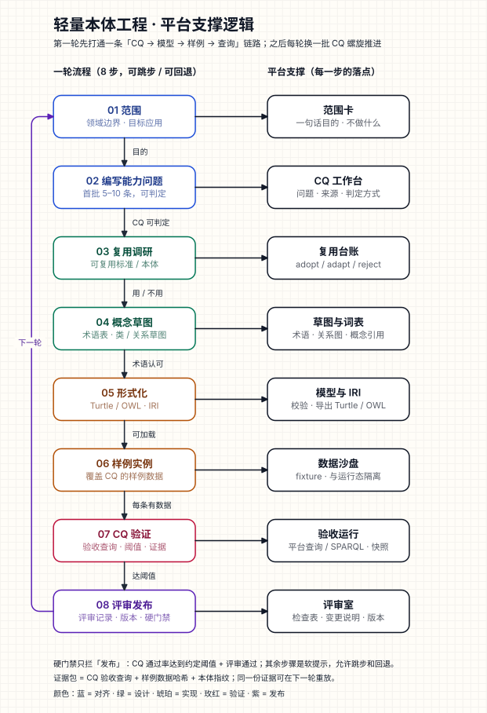

# 轻量本体工程流 · 平台功能设计方案（v1.3，步骤页签）

> 目标：把「范围 → CQ → 复用调研 → 概念草图 → 形式化 → 样例实例 → CQ 验证 → 评审发布」做成平台里**可执行、可追溯、可重放**的一轮工作，而不是一张流程说明。
>
> 配套逻辑图：[ontology-workflow-logic.svg](./ontology-workflow-logic.svg)
>
> 
>
> 本文保留设计推理；第 0.1 节记录**当前实现状态与边界**，第 6、7 节已按实现更新。未实现的能力会显式标注，不把设计当成已上线。

## 0.1 当前实现状态（P0 + 可用性增强）

已实现并进入测试：

- **轮次**：`workflow_round` 文档，`seq` 轮次号；状态 `active | in_review | accepted`；开始新一轮时如果当前本体已发布，自动调用现有 `ReviseOntology` 复制出草稿。
- **8 步状态**：由数据实时计算（`done | current | todo | warn`），可自由跳转；只有发布是硬门禁。
- **步骤页签**：8 步从纵向铺开改为页签卡片；一次只渲染当前步骤页，底部提供「上一页 / 下一页」，切换轮次时回到首个未完成步骤。
- **CQ 工作台**：增删改查、单条试跑、P0/P1/P2、模型引用校验、查询定义、期望定义；CQ 数量下限/上限与 P0/整体通过率阈值可在「范围」里按轮次配置。
- **CQ 导入导出**：CSV / Markdown / JSON 三种格式；导入支持中英文列名、整批先校验后落库（编号重复会整批拒绝），导出可直接给 Excel 打开。
- **复用台账**：人工记录 adopt/adapt/reject（实现字段为 `reuse|extend|build|skip`）与理由；可显式标记“本轮不复用”。
- **样例实例**：按对象类型分组的隔离 JSON 样例，支持从当前本体生成模板；保存时按当前本体检查未知对象类型/属性、关系两端引用；`objects` 最大 500 行/类型、2000 行总量。
- **验收运行**：支持两种引擎：
  - `fixture`：在样例 JSON 上执行 `object_type` 过滤或 `relation + ref + direction` 邻接查询；
  - `runtime`：通过现有运行时 gateway 读取已发布 workspace 的真实状态，适合“上线后回归”；
  - 共同支持 `row_count / rows_contain / golden_rows / empty / boolean / manual`。
- **证据**：每次运行记录 `seq`、本体指纹（16 位 canonical SHA-256）、样例哈希、查询哈希、引擎、结果摘要；本体/CQ/样例改动后旧证据自动过期。
- **评审发布**：评审通过要求“新鲜且通过”的验收运行；发布要求“新鲜校验 + 新鲜通过运行 + 已通过评审 + CQ 数量 + 必要的样例”；runtime-only 轮次不强制样例；发布调用现有 `PublishOntology`，并把 `published_version` 写回轮次。
- **报告与追踪矩阵**：CQ → 模型引用 → 样例 → 查询 → 期望 → 结果 → 评审；支持 Markdown/JSON 报告。
- **前端**：本体页第三个页签 `工程流`，包含轮次选择/新建、八步页签卡片、范围与门禁目标、CQ 工作台（导入/导出/试跑）、复用、结构摘要、语义检查、样例校验、验收、评审发布、门禁侧栏；结构编辑仍复用原有 `表格 / 关系图`，没有另造编辑器。
- **测试**：后端全量 806 项通过，新增 `tests/test_workflow.py` 12 项（含 REST 全链路与 runtime 引擎）；前端 82 项通过，新增 `src/lib/workflow.test.ts` 5 项；`pnpm build` 通过。

当前明确**未实现**：

- `runtime` 引擎支持对象类型过滤和关系邻接，但尚未接 `platform_query` / SPARQL / 聚合查询；复杂查询仍要拆成多条 CQ 或后续适配器。
- IRI/命名空间设置、模型 diff、评审人强制分离、通知/SLA、CQ 历史版本尚未实现。
- 复用台账不自动导入标准，不合并外部本体。
- 实现路径为 `src/onto_platform/domain/workflow/model.py`、`application/workflow_usecases.py`、`application/workflow_cq_io.py`；REST 路径见第 6 节，前端见第 7 节。

## 0. 一句话范围

**为谁回答什么问题**：为业务团队在某个应用场景下，回答一批**可判定、可追溯到来源**的能力问题（CQ）；平台负责把每个 CQ 追到本体元素、样例数据和验收证据，并以小版本发布。

示例：为高速收费运营回答「一辆车从入口到出口经过哪些站/门架、按什么规则计费、异常通行如何识别」——范围内的对象/关系、样例数据和验收查询都围绕这三类问题组织。

**不做什么**：

- 不做完整的 Ontology IDE（不替代 Protégé/ELK），也不做自动本体抽取；
- 不把 8 个步骤强制成瀑布状态机；
- 不把 CQ 只做成文档字段；没有执行方式或人工判定方式的 CQ 不能计入通过率；
- 不让样例数据污染生产运行态。

## 1. 判断与设计原则

1. **轮次是一等对象**：一个 workspace 同时只有一个“进行中的轮次”；评审发布后关闭，下一轮从已发布版本开新轮。
2. **CQ 是验收单元**：CQ → 模型引用 → 样例 → 验收结果 → 证据，五者必须能连成一条线。
3. **只有“发布”是硬门禁**：其余步骤都可以跳步、回退、重开；门禁以检查项和风险提示为主，不假装流程能替人做决定。
4. **证据先于结论**：每次验收记录查询原文、样例数据哈希、本体指纹、结果快照；同一份证据要能重放。
5. **复用现有能力**：草稿/校验/发布/修订、对象/关系/属性编辑、关系图、状态查询、Turtle/OWL 导出、审计与版本都已经存在；本轮主要补“轮次、CQ、样例、验收、评审”五类工作对象和数据串联。
6. **第一轮只打通一条链路**：默认 5–10 条 CQ、一个样例集、一次验收，不追求“建全”。

## 2. 总体逻辑

逻辑图分三部分：

- **左列（01）**：一轮流程的 8 个步骤，行间短标签是“退出条件”，末端有一条从底部回到顶部的「下一轮」回流。
- **右列（02）**：每一步在平台里的落点，从“范围卡”到“评审室”，说明 CQ 不是孤立表格，而是有存储、有查询、有证据的工作对象。
- **底部注**：硬门禁只拦发布；证据包由查询、样例哈希、本体指纹组成。

图中的步骤顺序只是**默认阅读顺序**，不是强制状态迁移；平台里每一步的状态由数据计算，允许自由跳转。

### 轮次的生命周期

轮次只有三个生命周期值：

| 值 | 含义 | 允许的操作 |
|---|---|---|
| `active` | 正在迭代 | 编辑范围/CQ/复用/样例；运行验收；提交评审 |
| `in_review` | 已提交评审，冻结本轮 CQ 与证据 | 评审通过/退回；退回后回到 `active` |
| `accepted` | 评审通过并随本体版本发布 | 只读；可复制为下一轮 |

8 个步骤各自的“进行中/通过/有风险”是**计算状态**，不是轮次生命周期。这样不会把轻量流程做成僵硬的状态机。

## 3. 八步与平台功能

### 3.1 步骤明细

| # | 步骤 | 平台界面与动作 | 产出 | 退出条件（建议） | 门禁 |
|---|---|---|---|---|---|
| 1 | 范围 | 「范围卡」表单：一句话目的、领域边界、目标应用、干系人、明确不做的事 | 范围卡 | 一句话目的 + 至少一个目标应用 | 软提示 |
| 2 | 编写能力问题 | CQ 工作台：表格 + 抽屉、CSV/Markdown 导入、按类型/优先级筛选 | CQ 清单 | 5–10 条；每条有来源、判定方式、优先级 | 软提示；不足 5 条标“风险” |
| 3 | 复用调研 | 复用台账：候选标准/本体、来源/版本/链接、决策（复用/扩展/自建/不复用）、理由 | 复用台账 | 每个候选都有决策和理由 | 软提示 |
| 4 | 概念草图 | 复用现有对象/关系/属性编辑与关系图；术语表；把 CQ 中的名词映射到概念 | 术语表 + 类/关系草图 | 领域专家认可术语和主要关系（评审记录/评审批注） | 软提示 |
| 5 | 形式化 | 现有本体编辑器 + IRI 设置；调用现有 validate/lint；导出 Turtle/OWL | 可加载的模型、命名空间/IRI | 语法通过、工具可加载；每个 CQ 至少有一个模型引用 | 硬检查（发布前） |
| 6 | 样例实例 | 「样例工作台」：JSON 样例集、对象与关系、从本体生成模板 | 样例集 + 行数 | 至少一组样例，且覆盖 P0 CQ 所需对象/关系 | 硬检查（发布前） |
| 7 | CQ 验证 | 验收运行：一次运行全部自动 CQ；预期结果断言；通过率、失败原因、证据快照 | 验收报告 | P0 CQ 全通过；总体达到阈值（默认 P0 100%，总体 ≥ 80%，可配置） | 硬检查（发布前） |
| 8 | 评审发布 | 评审室：自动检查表、模型 diff、CQ 覆盖与证据、评审意见、版本说明；调用现有 publish | 评审记录 + 版本 + 变更说明 | 评审通过；所有硬检查通过 | **硬门禁** |

### 3.2 关键说明

- **步骤 3 的“复用”不是导入器**：MVP 是人工台账，记录“用哪些、不用哪些、为什么”；自动导入标准/本体放到后续阶段。
- **步骤 4 不新增另一个画图器**：直接复用 `表格 / 关系图` 视图和词表；工程流只负责“把 CQ 名词映射到概念”的检查。
- **步骤 5 的“形式化”不替换现有发布模型**：仍然通过现有 `validate` / `publish`；新增的是“语义检查结果绑定本体指纹 + CQ 是否被模型覆盖”的检查。
- **步骤 6 的样例与运行态隔离**：样例集是轮次文档，不写 workspace 状态；`fixture` 引擎在样例 JSON 的内存 fixture 上执行，`runtime` 引擎只读已发布状态，两者都不会把样例写进运行时。
- **步骤 7 的查询引擎**：`fixture` 引擎（对象过滤 + 关系邻接 + 期望断言）用于隔离验证；`runtime` 引擎复用现有 gateway 读取已发布状态，适合真实数据回归；`platform_query` / `sparql` / 聚合查询仍是后续适配器，未知引擎明确报错，避免假通过。
- **步骤 8 的版本号**：`round.seq` 是轮次号，不是模型版本号；评审记录引用发布后的 `ontology.version` 和本体指纹，避免“第 2 轮就是 v2”的歧义。

## 4. 数据模型

> 本节保留设计期字段命名；**实际实现字段以第 6 节和代码为准**。主要差异：轮次用 `name / goal / status / scope / target / validation`；CQ 用 `expected / query / model_refs / sample_refs`；样例集直接存 `objects / relations`；运行与评审增加单调 `seq` 以解决同秒排序。

所有对象都带 `workspace_id` 和 `created_at / updated_at`；落成现有 repository 的独立文档集合，不把 CQ 塞进 ontology JSON。

```text
OntologyRound
  id, workspace_id, ontology_id, seq, title
  lifecycle: active | in_review | accepted
  scope: {
    purpose_one_liner, domain_in, domain_out, target_app_ids[],
    stakeholders[], out_of_scope[]
  }
  iri: { base_iri, prefixes[], term_overrides{} }
  threshold: { p0_required: 1.0, overall: 0.8 }
  baseline_version, published_version
  review_id?
  created_by, created_at, updated_at
```

```text
CQ
  id, round_id, code, question, type, priority (P0/P1/P2), source
  source_kind: document | interview | ticket | regulation | other
  expected: {
    kind: rows_contain | row_count | boolean | empty | golden_rows | manual,
    value? / rows? / note?
  }
  query: {
    engine: platform_query | sparql | manual,
    spec? / text?,
    timeout_ms, limit
  }
  model_refs: [{ kind: object | relation | property, name }]
  sample_ref_ids: []
  status: draft | ready | passing | failing | blocked | deferred
  notes
```

```text
ReuseDecision
  id, round_id, candidate_name, kind: standard | ontology | vocabulary
  version, uri, license
  decision: adopt | adapt | reject
  rationale, target_prefix?, target_namespace?
```

```text
SampleSet
  id, round_id, name, format: json | turtle
  content / object_rows, hash, loaded_at?
  covers: [{ cq_id, note }]
```

```text
AcceptanceRun
  id, round_id, run_by, run_at
  ontology_fingerprint, sample_hash
  engine, cq_ids[]
  summary: { total, passed, failed, blocked, manual }
  results: [{ cq_id, status, rows/boolean, duration_ms, error? }]
  evidence_bundle: { query_hashes[], result_hash, notes }
```

```text
ReviewRecord
  id, round_id, reviewer, decision: approved | changes_requested
  checklist: [{ item, ok, note }]
  comments
  ontology_version, schema_fingerprint
  evidence_hash
  reviewed_at
```

**追踪矩阵**不单独存储：由 `CQ.model_refs`、`SampleSet.covers`、`AcceptanceRun.results` 派生。矩阵视图列：CQ × 模型元素 × 样例 × 验收结果 × 证据。

## 5. 关键机制

### 5.1 轮次与现有生命周期

- 新建轮次时，如果当前本体是 `draft`，直接绑定该草稿；
- 如果当前本体已 `published`，先用现有 `POST /ontology/revisions` 创建修订草稿，再绑定；
- 轮次发布时，调用现有 `POST /ontology/publish`；发布成功后把 `round.published_version` 和本轮本体指纹写回轮次与评审记录；
- 下一轮从已发布版本开新轮；当前实现不自动复制 CQ，避免把旧断言默默带进新范围。需要沿用旧题时，用 CQ 卡上的「导出 CSV/Markdown/JSON」再导入新轮，导入后可逐条改期望。

### 5.2 验收查询与通过率

- **fixture（默认）**：结构化查询只支持两类安全形态：按 `object_type` 过滤对象属性，或按 `relation + ref + direction` 查邻接对象；过滤操作符 `eq/ne/contains/in/exists/gt/gte/lt/lte`。不使用任意 Python 代码。
- **runtime（当前实现）**：通过现有 gateway 读取已发布 workspace 的状态；支持同样的对象过滤与关系邻接，但不支持 SPARQL/聚合；本体未发布时 CQ 明确报错，**不会**降级成“跑通即通过”。
- **platform_query / sparql（后续）**：接口已为查询种类留字段；未知引擎明确报错并让 CQ 失败/报错。
- **单条试跑**：CQ 行上的「试跑」只返回结果，不写入运行历史，用于修查询/期望时不污染正式证据。
- **manual**：允许“人工判定”，但必须填判定说明；不计入自动通过率，发布检查把它列为“人工证据”而不是通过项。
- 每条 CQ 的 `expected.kind` 必须明确，避免“查询跑通了就算通过”。
- 默认阈值：P0 100%，总体 ≥ 80%；阈值存轮次 `target`，发布检查使用同一份阈值，可在「范围」卡里按轮次调整。
- 失败结果保留错误摘要和结果快照，不把整份大结果塞进审计事件。

### 5.3 样例数据隔离

样例集是轮次文档，验收时**不写入** workspace 状态：

1. `fixture` 读取轮次绑定本体与轮次样例，在内存中按 `objects` / `relations` 构建数据集，再执行查询和断言；
2. `runtime` 只通过 gateway 读取已发布状态，不写 state；
3. 样例与运行只保存结果快照与哈希，样例本身仍留在轮次文档里；
4. 保存样例时按当前本体检查对象类型、属性名和关系两端引用，问题作为警告显示在样例卡和发布前检查里，不阻止继续编辑。

样例数据当前存文档，已限制 500 行/类型、2000 行总量；更大样例应迁移到独立存储。

### 5.4 评审与“maker-checker”

- MVP 允许同一编辑者准备并提交评审，但评审记录必须独立填写结论；
- 团队模式下建议配置“评审人不能是本轮最后一位模型编辑者”（后续加，不阻塞 MVP）；
- 评审通过前，轮次可退回 `active` 并保留全部证据；
- 发布失败（校验/兼容性）不消耗评审结论，但要在评审室显示失败原因。

### 5.5 权限与审计

- 复用现有 `viewer / editor / owner`：viewer 只读；editor 可建轮次、CQ、样例、运行验收、提交评审；owner 可发布/覆盖硬门禁；
- 新增事件：`round.created`、`round.submitted`、`cq.created/updated`、`acceptance.run`、`review.recorded`、`round.published`；
- 事件只记摘要、计数、哈希和对象引用，不记完整样例数据。

### 5.6 一条链路的样例（评审时可直接对照）

以 `CQ-001` 为例，平台里的完整链路应当长这样：

| 环节 | 内容 |
|---|---|
| CQ | “一辆车从入口到出口经过哪些门架、应按什么规则计费？” |
| 来源 | 收费规则文档第 3.2 节 + 运营访谈 2026-xx-xx |
| 验收方式 | `fixture`（当前）或后续 `platform_query`，`expect.kind = rows_contain`，期望行包含入口站、出口站、门架序列、计费规则 |
| 模型引用 | `Vehicle`、`TollEntry`、`TollExit`、`Gantry`、`FeeRule` |
| 样例引用 | `sample-001`：2 辆车、2 条入口/出口记录、3 个门架、1 条规则 |
| 验收结果 | 通过 / 失败 / 阻断；失败时保留查询、期望、实际行和错误 |
| 证据包 | 查询文本哈希 + 样例哈希 + 本体指纹 + 结果哈希 |
| 评审发布 | 评审记录引用上述证据包；发布后写入 `round.published_version` |
| 下一轮 | 复制 `CQ-001` 为 `draft`，在新样例上重跑或改成 SPARQL 验收 |

这条链路就是第一轮“打通一条从模型到查询的链路”的最小验收对象；其余 CQ 都按同一结构复制。

## 6. API（已实现）

所有接口挂在现有 workspace 作用域下；下面是相对路径（前缀 `/api/workspaces/{wid}`）。读接口要求 viewer，写接口要求 editor；写操作会记录审计事件。

| 方法 | 路径 | 用途 |
|---|---|---|
| GET | `/ontology/workflow?round_id=` | 轮次总览（默认进行中轮次）+ 完整详情 |
| GET | `/ontology/workflow/rounds` | 轮次列表 |
| POST | `/ontology/workflow/rounds` | 创建新一轮（自动修订已发布本体） |
| GET/PATCH | `/ontology/workflow/rounds/{rid}` | 详情 / 更新范围、目标、绑定 |
| POST | `/ontology/workflow/rounds/{rid}/bind` | 显式绑定当前草稿 |
| POST | `/ontology/workflow/rounds/{rid}/next` | 基于本轮开下一轮 |
| POST | `/ontology/workflow/rounds/{rid}/check` | 运行语义检查并绑定本体指纹 |
| GET/POST | `/ontology/workflow/rounds/{rid}/cqs` | CQ 列表 / 新增 |
| GET | `/ontology/workflow/rounds/{rid}/cqs/export?format=csv\|markdown\|json` | 导出 CQ 集 |
| POST | `/ontology/workflow/rounds/{rid}/cqs/import` | 从 CSV/Markdown/JSON 整批导入（先校验后落库） |
| POST | `/ontology/workflow/rounds/{rid}/cqs/{cid}/run` | 单条 CQ 试跑（不写运行历史） |
| PATCH/DELETE | `/ontology/workflow/rounds/{rid}/cqs/{cid}` | 修改 / 删除 CQ |
| GET/POST | `/ontology/workflow/rounds/{rid}/reuse` | 复用台账 |
| PATCH/DELETE | `/ontology/workflow/rounds/{rid}/reuse/{item}` | 修改 / 删除复用记录 |
| GET/POST | `/ontology/workflow/rounds/{rid}/samples` | 样例集 |
| PATCH/DELETE | `/ontology/workflow/rounds/{rid}/samples/{sid}` | 修改 / 删除样例集 |
| GET/POST | `/ontology/workflow/rounds/{rid}/runs` | 验收运行历史 / 运行全部自动 CQ |
| GET/POST | `/ontology/workflow/rounds/{rid}/reviews` | 评审历史 / 提交评审结论 |
| GET | `/ontology/workflow/rounds/{rid}/trace-matrix` | CQ × 模型 × 样例 × 结果矩阵 |
| GET | `/ontology/workflow/rounds/{rid}/publish-check` | 发布前硬检查（blockers/warnings） |
| POST | `/ontology/workflow/rounds/{rid}/publish` | 发布本轮（调用现有本体发布） |
| GET | `/ontology/workflow/rounds/{rid}/report` | 评审/证据报告（Markdown + JSON） |

现有 `/ontology/*`、`/standards/*`、`/state/*` 不破坏；新增接口只服务轮次。

## 7. 前端交互设计

### 7.1 入口

在现有本体页增加第三个子页签：`表格 | 关系图 | 工程流`。已实现：

- 工程流与“当前本体”强相关，放在同一页避免跨页面找上下文；
- 现有表格/关系图保持原样，工程流是新增工作台，不改默认视图；
- 页签常驻，工程流内可一键回到 `表格` / `关系图` 编辑结构。

顶部：轮次选择器（第 N 轮）、新建轮次、状态标签和八步进度；下面是 8 个可点击的步骤页签卡片，按平台支撑命名：范围卡、能力工作台、复用台账、草图和词表、模型与 IRI、数据沙盘、验收运行、评审室，显示 `完成 / 当前 / 未开始 / 待修正`。点击卡片只把主区域切换到该步骤页，不同时铺开 8 块工作区；主区域底部的「上一页 / 下一页」用于按顺序翻页。

### 7.2 主区域

```text
┌ 工程流   [第 2 轮 ▾]  [开下一轮]              [新轮次] ┐
│ [①范围] [②CQ] [③复用] [④草图] [⑤形式化] [⑥样例] [⑦验证] [⑧评审] │
│  页签卡片：高亮当前页，其余显示完成/当前/待修正状态             │
├──────────────────────────────────────┬─────────────────┤
│ 当前步骤页（只渲染这一页）           │ 发布门禁        │
│ 例如 07 · CQ 验证                    │ 阻塞 / 提醒     │
│ [上一页]        第 7 / 8 页        [下一页] │ 本轮证据        │
│                                      │ 下一步          │
└──────────────────────────────────────┴─────────────────┘
```

### 7.3 各步骤交互（已实现）

1. **范围**：目标、范围摘要、范围内/外、参与角色，以及本轮 CQ 下限/上限、P0/整体通过率目标；列表字段用逗号分隔，保存写回轮次。
2. **CQ**：列表 + 内联编辑器；支持编号、优先级、类型、来源、模型引用、查询引擎（样例 fixture / 运行时 runtime）、查询（对象过滤或关系邻接）、期望结果（行数/包含行/黄金行/为空/布尔/人工）、备注；支持 CSV/Markdown/JSON 导入导出、单条试跑；保存时校验 JSON 与引用。
3. **复用**：台账列表 + 折叠表单；记录标题、决策、来源、链接、说明；支持“本轮不复用”显式标记。
4. **草图**：只读展示对象/关系标签，深链回表格或关系图；不复制编辑器。
5. **形式化**：展示语义检查结果与时间；检查结果绑定当前本体指纹，改结构后自动过期。
6. **样例**：样例集列表 + JSON 编辑器；可从当前本体生成模板；显示对象行数与关系数，并展示与本体不一致的属性/类型/关系引用。
7. **验证**：一键运行全部自动 CQ；展示整体/P0 通过率、自动/人工数量、逐条结果和每条引擎；可展开追踪矩阵。
8. **评审**：显示最近评审；填写意见后通过/要求修改/驳回；门禁侧栏实时列出 blockers/warnings；通过且门禁清空后可发布；已发布可开下一轮。

**未实现**：IRI/命名空间设置、模型 diff、CQ 名词高亮、评审人强制分离、通知/SLA；空态与错误态已按“没有轮次/CQ/样例/运行/门禁”分别给出引导。

## 8. 与现有模块的集成

| 现有能力 | 在工程流里的用法 | 需要新增/修改 |
|---|---|---|
| 本体草稿/校验/发布/修订 | 步骤 4–8 的模型与发布 | 轮次绑定；发布前 `publish-check` |
| 对象/关系/属性编辑 | 步骤 4 概念草图、步骤 5 形式化 | 不加新编辑器；加 IRI 设置 |
| 关系图 | 步骤 4 草图查看、CQ 名词高亮 | 深链与选中态参数（可选） |
| 术语表 | CQ 名词到概念的映射 | 增加“未映射”检查 |
| standards 插件（Turtle/OWL/SKOS） | 步骤 5 导出；步骤 7 SPARQL（后续） | IRI base/prefix 配置；SPARQL engine 接口 |
| 状态查询 `/state/find` 等 | `runtime` 验收入口 | 已接 gateway 只读；聚合/platform_query/SPARQL 后续 |
| revisions / releases / audit | 版本、证据、事件 | round 事件与报告 |
| AI 草稿 | 可选：起草 CQ 或概念候选 | 只作草稿，必须人工确认 |

## 9. 实施阶段

### P0：先把链路打通（已落地当前子集）

已完成：

- `workflow_round` / `workflow_cq` / `workflow_reuse` / `workflow_sample` / `workflow_run` / `workflow_review` 六类文档与 API；
- 工程流第三页签、八步页签卡片、范围与门禁目标、CQ 工作台（导入/导出/试跑）、复用台账、样例编辑与校验、验收运行、评审/发布门禁；
- `fixture` 与 `runtime` 两种验收引擎（对象过滤 + 关系邻接 + 期望断言）；
- 追踪矩阵、发布前检查、Markdown/JSON 报告；
- 权限、审计、后端 12 项工程流测试（含 REST 全链路与 runtime 发布）、前端 5 项视图模型测试。

尚未完成（不阻塞当前链路）：

- `platform_query` / SPARQL / 聚合查询验收引擎；
- IRI/命名空间设置、模型 diff；
- 评审人强制分离、通知/SLA、CQ 版本历史；
- 前端产物已能构建，但本环境未做完整浏览器人工点检。

**当前完成判据**：一个 workspace 能从空轮次开始，录入 5 条 CQ、1 个样例集（或 5 条 runtime CQ），运行出 5 条结果，提交评审并通过发布；刷新后证据仍在；同证据重跑结果一致（由单调 `seq` 与哈希保证）。

### P1：把“标准化”接上

- IRI/命名空间设置与现有 Turtle/OWL 导出打通；
- 复用台账与导出前缀/标准清单联动；
- 模型 diff 摘要。

### P2：自动与扩展

- SPARQL 验收引擎（接 standards 插件）；
- 标准/本体自动导入与候选推荐；
- AI 生成 CQ/概念候选（人工确认）；
- 评审人分离、评审 SLA、通知。

## 10. 验收与测试（当前实际）

- **后端全量**：`python -m pytest -q` → 806 passed。新增 `tests/test_workflow.py`：
  - 轮次生命周期、八步状态、评审发布、下一轮自动修订；同一 workspace 只允许一个未关闭轮次；
  - 本体改动、CQ/期望改动、样例改动都会让旧证据过期，失败 CQ 阻断发布；
  - 模型引用必须存在；
  - 没有通过运行不能评审通过；评审后重跑需要重新确认评审；
  - CQ CSV/Markdown/JSON 导入导出、编号冲突整批拒绝、单条试跑；
  - runtime 预览、runtime-only 无样例验收与发布；
  - 样例与本体不一致的警告、可配置 CQ 数量/通过率目标；
  - REST 全链路与导出/试跑路由：建轮 → CQ ×5 → 样例 → 语义检查 → 运行 → 评审 → 发布 → 报告。
- **前端**：`pnpm test` → 82 passed（新增 `src/lib/workflow.test.ts` 5 项，覆盖步骤进度、状态标签、引用拆分、查询/期望摘要、JSON 解析）；`pnpm build` 通过（`tsc --noEmit` + Vite 生产构建）。
- **未覆盖**：完整浏览器人工点检、真实生产数据验收、SPARQL/platform_query、并发编辑冲突。

## 11. 风险与取舍

| 风险 | 取舍 |
|---|---|
| 流程变重、团队绕过 | 第一轮只要求最少字段；步骤可跳；把“通过率”做成帮助而非审批游戏 |
| CQ 写成文档、无法执行 | `expect.kind` + query/manual 必填；无法判定的 CQ 标 blocked，不计入通过率 |
| 样例与真实数据漂移 | 样例哈希 + 本体指纹写进证据；明确“样例验证不是生产数据验证” |
| SPARQL 适配器尚未实现 | 先用 `fixture` + `runtime` 两种引擎；SPARQL/聚合作为可插拔 engine，不让流程等依赖 |
| 复用标准有许可证/版本风险 | 台账记录 license/version/URI；不自动合并；人工决策 |
| 轮次号与模型版本混淆 | 分开存 `round.seq` 与 `ontology.version`；评审记录同时引用两者 |
| 沙箱实现成本 | 优先内存 runtime；退路是独立隐藏 workspace；隔离方式写进证据 |

## 12. 已拍板的默认值

以下设计期问题已按默认值实现，后续仍可调整：

1. **入口**：工程流放在本体页第三页签（已实现）。
2. **查询引擎顺序**：`fixture` 做隔离验证，`runtime` 做真实状态回归；platform_query / SPARQL 后续接入。
3. **通过率默认值**：P0 100%，总体 ≥ 80%；存轮次 `target`，可配置。
4. **评审角色**：MVP 允许同一人提交并评审，但自评审只记为 warning，不阻止发布；强制 maker-checker 后续加。
5. **样例隔离**：`fixture` 不写生产 state；`runtime` 只读已发布状态；沙箱 runtime 作为后续替换。
6. **人工 CQ**：允许 `manual`，不计入自动通过率，但在发布检查中显示为人工证据。
7. **复用台账**：MVP 只做人工记录，不做标准导入。

> 下一步优先级：先拿真实项目跑一轮，再决定是否先补 `platform_query`/聚合查询还是 IRI/模型 diff。
