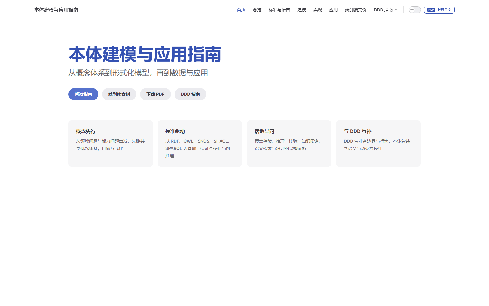
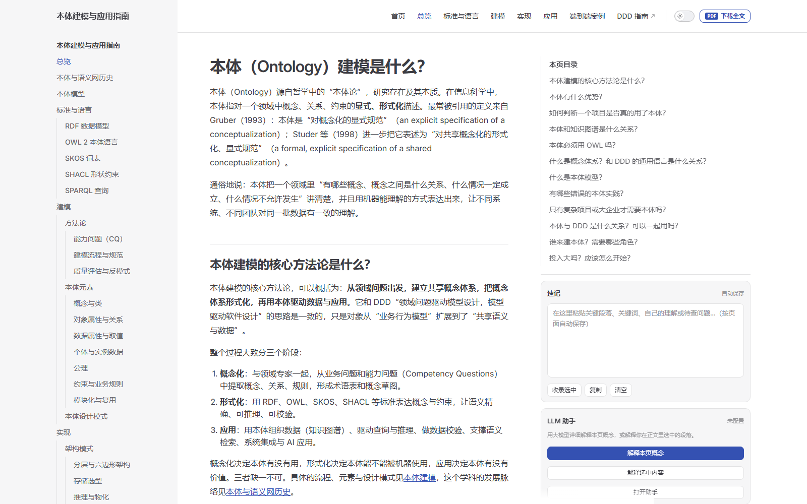
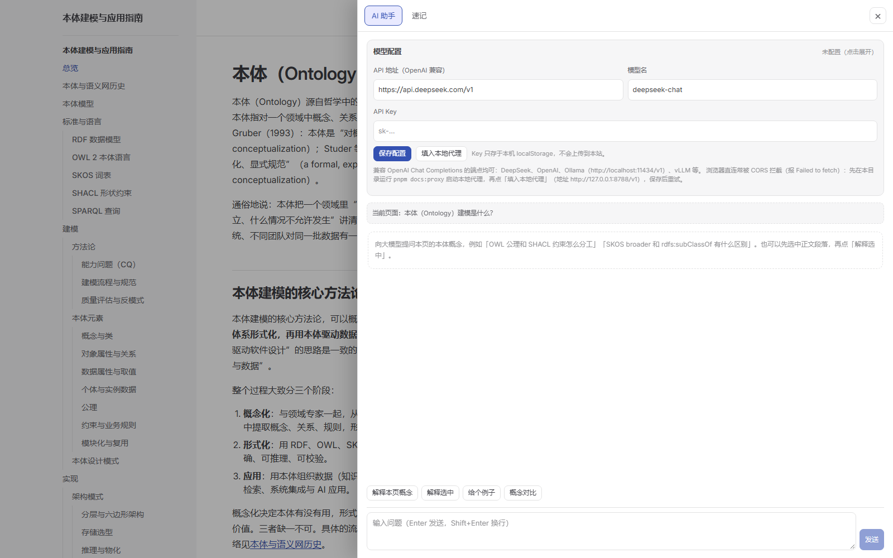

# 本体建模与应用指南（Ontology Guide）

从概念体系到形式化模型，再到数据与应用的中文本体建模指南。内容覆盖总览、语义网与本体历史、标准与语言（RDF/OWL/SKOS/SHACL/SPARQL）、建模方法论与本体元素、实现架构与技术栈、应用场景、落地路线图与端到端案例，共 44 页。

本目录是一个独立的 VitePress 站点，可单独构建与部署，也可作为 ontoPlantform 平台的文档子项目。

## 界面速览

站点整体宽度按 `max(90vw, 1440px)` 横向自适应：大屏不再被固定正文列限制，正文、右侧速记栏和助手抽屉都会随可用宽度展开。以下截图来自 1600×1000 的真实运行页面。

### 首页



首页用「概念先行 / 标准驱动 / 落地导向 / 与 DDD 互补」四张卡片概括指南定位，并提供「阅读指南」「端到端案例」「下载 PDF」「DDD 指南」四个入口；顶栏的「PDF 下载全文」可下载整站合并版。

### 阅读页：正文、目录与速记



正文页保持左侧多级导航、中间阅读列和右侧速记栏。速记内容按页面路径自动保存在浏览器 `localStorage`，支持收录选中文字、复制、清空和导出 `.md`；窄屏时右侧栏收起，改用右下角「速记 / AI」浮动入口。

### LLM 助手



「打开助手」会展开 960px 宽的抽屉：可在这里配置 OpenAI Chat Completions 兼容接口，解释本页概念或选中内容，并把回答插入速记。模型配置只保存在本机浏览器；浏览器直连被 CORS 拦截时，可用本目录的 `pnpm docs:proxy` 本地代理。

## 页面增强功能

- **右侧速记**：每个文档页右侧栏内嵌速记编辑框，可粘贴关键段落、关键词、自己的理解或待查问题；内容按页面自动保存到浏览器 `localStorage`（键 `ontology-guide:notes:v1:<path>`）。支持「收录选中」（把正文选中文字追加进来）、复制、清空，抽屉内还可导出 `.md`。窄屏侧栏隐藏时，通过右下角「速记 / AI」浮动按钮打开。右侧栏已加宽一倍：内容区由 224px 放宽到最大 448px（`clamp(300px, 26vw, 448px)` 随视口自适应），速记框与助手面板更易读。
- **LLM 助手**：用大模型对本体概念做详细解释，入口为右侧栏「解释本页概念 / 解释选中内容」以及抽屉内的问答区；回答可一键「插入速记」或复制。抽屉宽度由 480px 加倍到 960px，模型配置区在宽抽屉下自动两列、提问框与发送按钮横排。
  - 在抽屉「模型配置」中填写 OpenAI Chat Completions 兼容接口：API 地址（如 `https://api.deepseek.com/v1`）、模型名（如 `deepseek-chat`）、API Key。
  - 配置只保存在本机浏览器 `localStorage`（键 `ontology-guide:llm:v1`），不会上传到本站。
  - 浏览器直连常被 CORS 拦截（报 `Failed to fetch`）：用下面的内置代理即可，或改用允许跨域的服务（如本地 Ollama `http://localhost:11434/v1`、vLLM）。
  - 请求超时 90 秒；失败时在对话中给出可读的错误原因与排查提示。
- **本地代理 `pnpm docs:proxy`**（零依赖，Node 18+）：解决浏览器直连大模型 API 的 CORS 问题。
  ```bash
  pnpm docs:proxy
  # 指向官方 API（默认）：
  # LLM_UPSTREAM=https://api.deepseek.com/v1 LLM_API_KEY=sk-xxx pnpm docs:proxy
  # 指向本机 OpenAI 兼容服务（例如 llmrouter、vLLM、Ollama）：
  # PowerShell: $env:LLM_UPSTREAM='http://127.0.0.1:8000/v1'; pnpm docs:proxy
  ```
  启动后在「模型配置」里点**「填入本地代理」**（API 地址变为 `http://127.0.0.1:8788/v1`），模型名/Key 按上游要求填写即可。代理只监听 `127.0.0.1`；API Key 默认由页面请求头 `Authorization` 透传，也可用环境变量 `LLM_API_KEY` 兜底。若 8788 被占用，用 `PORT=8789 pnpm docs:proxy` 启动并相应修改地址。
  - 本机示例：`R:\target\release\llmrouter.exe` 监听 `127.0.0.1:8000` 时，用 `$env:LLM_UPSTREAM='http://127.0.0.1:8000/v1'; pnpm docs:proxy`，页面配置 `http://127.0.0.1:8788/v1` + `deepseek-v4-flash`（Key 可填任意值，llmrouter 不校验）。
- **思考型模型**：`max_tokens` 默认 4096，避免推理内容占满预算导致正式回答为空；若仍只返回推理过程，页面会显示提示与推理内容，可重试。
- **横向自适应布局**：整页布局宽度改为 `max(90vw, 1440px)`——大屏按视口 90% 自适应铺开，替代默认 1440px 固定宽度；正文列不再限制在 688px，随窗口变宽而变宽。右侧栏同步加宽后，1920px 屏下正文约 833px、右栏工具区 448px。
- **整站 PDF 下载**：顶栏「PDF 下载全文」按钮、右侧栏「下载 PDF 全文」以及首页「下载 PDF」动作，均可下载整站合并的 PDF（封面 + 目录 + 43 节，A4 约 170 页，≈4.7 MB），地址为 `/ontology-guide.pdf`。封面含 **GIT 仓库地址标签**（`loongWoong/ontoPlantform`，可点击）与 **GIT 用户标签**（`loong`），作为作者来源标识；可用环境变量 `PDF_REPO_URL`、`PDF_GIT_USER` 覆盖。
  - 内容更新后重新生成：`pnpm docs:build && pnpm docs:pdf`（`docs:pdf` 会自动把 PDF 同步进 `dist`，无需再 build 一次）。生成依赖本机 Chrome/Edge（可用 `CHROME_PATH` 指定路径），源文件位于 `docs/public/ontology-guide.pdf`。

## 目录结构

```
ontology-guide/
├─ docs/
│  ├─ index.md                  # 站点首页
│  ├─ main.md                   # 总览（FAQ）
│  ├─ history.md                # 本体与语义网历史
│  ├─ ontology-model.md         # 本体模型：是什么、不是什么
│  ├─ spec/                     # 标准与语言（RDF、OWL 2、SKOS、SHACL、SPARQL）
│  ├─ modeling/                 # 建模：方法论、本体元素、设计模式
│  ├─ impl/                     # 实现：架构模式、本体对象、JVM/Python/JS 技术栈
│  ├─ application/             # 应用：知识图谱、语义检索与 RAG、数据治理等
│  ├─ adoption/index.md         # 落地路线图
│  ├─ examples/index.md         # 端到端案例（电商本体）
│  ├─ public/
│  │  ├─ ontology-guide.pdf     # 整站合并 PDF（由 scripts/build-pdf.mjs 生成）
│  │  └─ screenshots/           # README 界面速览截图
│  └─ .vitepress/
│     ├─ config.mts             # 站点配置（导航、侧边栏、语言）
│     └─ theme/                 # 自定义主题：速记 + LLM 助手 + PDF 按钮 + 布局宽度
│        ├─ index.ts            # 继承默认主题并挂载 aside/drawer/nav 插槽
│        ├─ styles.css          # 组件样式、右侧栏加宽与 90vw 横向自适应布局
│        ├─ components/         # AsideTools / AssistantDrawer / LauncherButton / DownloadPdf
│        └─ composables/        # useNotes、useAi、useSelection、useUi、pageContext
├─ scripts/
│  ├─ build-pdf.mjs             # 生成整站 PDF（Chrome headless 打印）
│  └─ llm-proxy.mjs             # LLM 本地代理（解决 CORS）
├─ package.json
├─ pnpm-workspace.yaml
└─ README.md
```

## 本地开发

```bash
pnpm install
pnpm docs:dev      # 开发服务器
pnpm docs:build    # 生产构建，输出到 docs/.vitepress/dist
pnpm docs:preview  # 预览构建结果
```

## 部署

配置中的 `base` 目前是 `"/"`，即部署在域名根路径。若发布到 GitHub Pages 的仓库子路径（例如 `https://<org>.github.io/ontology-guide/`），请把 `docs/.vitepress/config.mts` 中的 `base` 改为 `"/ontology-guide/"` 后重新构建。

## 与 DDD 指南的关系

本指南在领域建模方面参考了 [DDD 指南](https://ddd-fans.github.io/ddd-guideline/) ：DDD 管理业务边界与行为，本体管理共享语义与数据互操作。正文中指向 DDD 指南章节的链接使用已发布站点的绝对地址；其余站内链接均指向本指南自身页面。

## 许可

沿用 [CC BY-SA 4.0](LICENSE) 许可协议。
